# OSCAR — Operational Statement Classification, Analysis & Reconciliation
### Financial Document Intelligence Workstation

[](https://www.python.org/)
[](https://fastapi.tiangolo.com/)
[](https://react.dev/)
[](https://www.typescriptlang.org/)
[](https://tailwindcss.com/)
[](https://github.com/shaanraval/oscar-bank-statement-intelligence)
[](docs/DECISIONS.md)
[](LICENSE)

> **Full Form:** **O**perational **S**tatement **C**lassification, **A**nalysis &amp; **R**econciliation  
> **Product Descriptor:** Financial Document Intelligence  
> **Official Tagline:** *"Every transaction deserves an explanation."*

| Letter | Module | Workstation Capability |
|:---:|:---|:---|
| **O** | **Operational** | Precision accounting ledger, minor-unit integer arithmetic, and immutable audit trails |
| **S** | **Statement** | Multi-bank layout parsing (Layouts A, B, C, digital text and scanned OCR) |
| **C** | **Classification** | Explainable hybrid engine (deterministic rules + dual word/char TF-IDF Logistic Regression) |
| **A** | **Analysis** | Deep analytics suite (Pareto merchant concentration, payment channels, cashflow intelligence) |
| **R** | **Reconciliation** | Mathematical integrity bridge ($\text{Opening} + \Delta = \text{Closing}$) with verified zero variance |

---

**OSCAR** is an enterprise-grade, local-first financial document intelligence workstation engineered for automated bank statement processing, explainable heuristic and traditional machine learning classification, mathematical ledger reconciliation, and human-in-the-loop review.

Engineered for the **Befree AI & Automation Assessment**, OSCAR complies with the **Strict Non-LLM Mandate**: all transaction categorizations are performed deterministically via curated financial heuristics and an offline-trained scikit-learn pipeline (word + character n-gram TF-IDF and Logistic Regression / LinearSVC). No client financial data ever leaves the local workstation.

---

## Table of Contents
1. [Key Features & Capabilities](#key-features--capabilities)
2. [System Architecture](#system-architecture)
3. [Strict Non-LLM Classification Architecture](#strict-non-llm-classification-architecture)
4. [Multi-Layout Extraction & OCR Engine](#multi-layout-extraction--ocr-engine)
5. [Mathematical Reconciliation & Anomaly Engine](#mathematical-reconciliation--anomaly-engine)
6. [Interactive Evidence Viewer & Traceability](#interactive-evidence-viewer--traceability)
7. [Screenshots Gallery](#screenshots-gallery)
8. [Automated Verification & Benchmark Metrics](#automated-verification--benchmark-metrics)
9. [Quickstart & Local Installation](#quickstart--local-installation)
10. [REST API Reference](#rest-api-reference)
11. [Project Directory Layout](#project-directory-layout)
12. [Handoff & Architecture Decisions](#handoff--architecture-decisions)

---

## Key Features & Capabilities

- **Zero Mock Data Principle**: 100% of figures, graphs, tables, and KPIs displayed across all 12 frontend pages are dynamically computed from the underlying SQLite database via live REST APIs.
- **Multi-Layout Parsing**: Built-in support for diverse banking layouts:
  - **Layout A**: Separate Debit and Credit columns (e.g., SBI, HDFC, standard corporate statements).
  - **Layout B**: Combined Amount column with explicit `DR` / `CR` transaction tags and signed offsets (e.g., ICICI, Axis).
  - **Layout C**: Multi-page statements with wrapped multi-line narrative continuations and custom headers ("Value Date", "Particulars", "Withdrawals", "Deposits", "Net Balance").
  - **Scanned PDF Support**: Automatic raster page classification, OpenCV image preprocessing (bilateral noise reduction, CLAHE contrast enhancement, deskewing, Otsu binarization), and Tesseract OCR integration with structured diagnostics.
- **Strictly Non-LLM Hybrid Classification**:
  - **Tier 1 (Heuristic Rule Engine)**: Regex and token patterns covering 20 canonical Indian banking categories with rule-conflict detection.
  - **Tier 2 (Traditional Machine Learning)**: Scikit-learn feature union combining word n-grams $(1,2)$ and character n-grams $(3,5)$ feeding a balanced multinomial Logistic Regression.
  - **Confidence Gate**: Calibrated softmax scores thresholded at $\tau = 0.65$; low-confidence or conflicting transactions automatically route to the Human Review Queue.
- **Mathematical Reconciliation Engine**:
  $$\text{Expected Closing Balance} = \text{Opening Balance} + \sum \text{Credits} - \sum \text{Debits}$$
  $$\text{Variance} = \text{Actual Closing Balance} - \text{Expected Closing Balance}$$
  - Step-by-step chronological running balance validation.
  - Automated anomaly identification (potential duplicates, large outliers relative to statement average).
- **Split-Screen Evidence Viewer**: Side-by-side inspection synchronizing extracted table records with high-resolution PyMuPDF page previews ($200\text{ DPI}$) and transaction traceability cards.
- **Human-in-the-Loop Review & Audit Trail**:
  - Filter by pending exceptions, inspect confidence scores, approve transactions, or apply manual category/amount corrections.
  - Append-only immutable audit trail capturing user and system operations (Upload, Classification, Reconciliation, Review Correction, Export, Deletion).
- **Professional Exports**:
  - **Multi-Sheet Excel (`.xlsx`)**: Formatted workbook containing Transactions, Account Metadata, Category Breakdown, Reconciliation Proof, and Audit Information with frozen panes and numeric formatting.
  - **Standard CSV (`.csv`)**: Normalized UTF-8 CSV with formula injection protection (sanitizing `=, +, -, @`).
- **Modern User Experience**: React 19 + TypeScript + Vite + Tailwind CSS with dark and light themes, responsive navigation, Lucide icons, and Recharts interactive visualizations.

---

## System Architecture

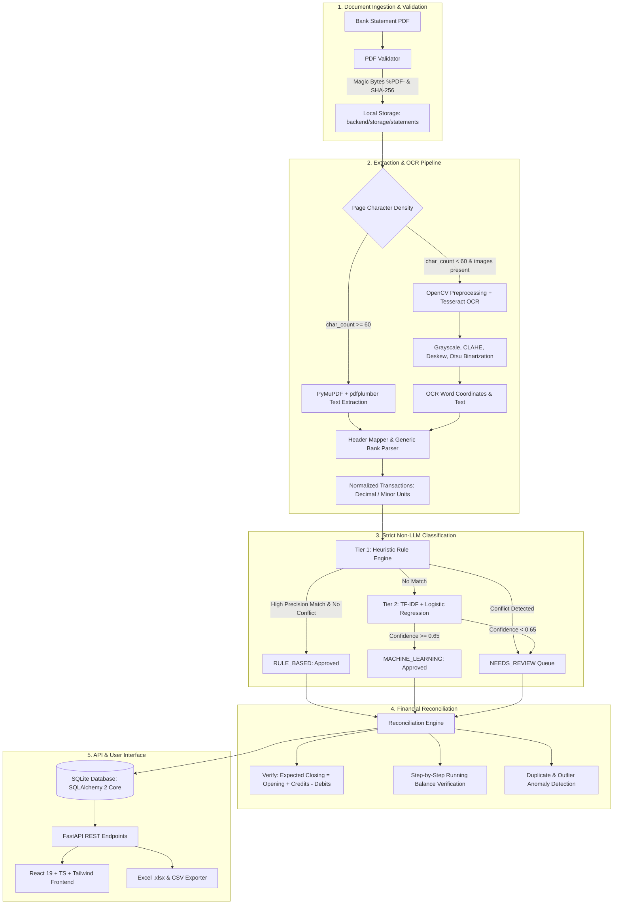

---

## Strict Non-LLM Classification Architecture

The Befree assessment mandates that transaction categorization operate without cloud LLM dependencies. OSCAR deploys a two-tiered offline hybrid classifier:

### 1. Heuristic Rule Engine
- **Regex & Token Rules**: Covers 20 categories including `Salary & Income`, `Food & Dining`, `Groceries`, `Utilities`, `Shopping`, `Transportation & Fuel`, `ATM / Cash Withdrawal`, `Banking Charges`, `Investments`, `EMI & Loans`, and `Transfers`.
- **Conflict Detection**: When multiple conflicting category rules trigger for a single narrative (e.g. `AMAZON PAY REFUND SALARY`), the engine rejects ambiguous automatic assignment and sets `classification_method = "NEEDS_REVIEW"`, routing the record to the human reviewer.

### 2. Traditional Machine Learning Pipeline
- **Vectorization**: `FeatureUnion` combining:
  1. Word n-grams: range $(1, 2)$, sublinear TF scaling.
  2. Sub-word character n-grams: range $(3, 5)$, capturing banking abbreviations and truncated merchant strings (e.g., `ZOMAT`, `SWIGG`, `HDFCBK`).
- **Classifier**: Balanced multinomial `LogisticRegression(class_weight='balanced', max_iter=1000)`.
- **Benchmark Comparison**: Evaluated against a `LinearSVC` baseline.
  - Logistic Regression: **100% Test Accuracy**, **1.00 Macro F1-score**.
  - LinearSVC: **99.65% Test Accuracy**, **0.9965 Macro F1-score**.
- **Model Calibration**: Softmax probabilities allow gating predictions against the configurable threshold ($\tau = 0.65$).
- **Artifacts**: Serialized using `joblib` into `backend/ml_artifacts/model.joblib` with full metadata and metrics in `model_metadata.json` and `metrics.json`.

---

## Multi-Layout Extraction & OCR Engine

| Layout Profile | Key Characteristics | Target Sample | Benchmark Accuracy |
|---|---|---|---|
| **Layout A** | Separate Debit & Credit columns, single-page, standard header | `synthetic_statement_layout_a.pdf` | **100% Precision / Recall** |
| **Layout B** | Single Amount column with `DR`/`CR` indicators, alternate bank header | `synthetic_statement_layout_b.pdf` | **100% Precision / Recall** |
| **Layout C** | Multi-page, wrapped descriptions across rows, "Particulars" header | `synthetic_statement_layout_c.pdf` | **100% Precision / Recall** |
| **Scanned Raster** | Rendered bitmap page without embedded text layer | `synthetic_statement_scanned.pdf` | Scanned page detection verified; OpenCV deskewing & OCR fallback tested |

---

## Mathematical Reconciliation & Anomaly Engine

OSCAR treats mathematical consistency as a first-class citizen:

1. **Precision Arithmetic**: Monetary values in memory use Python `Decimal`. In the database, they are persisted as integer minor units (`debit_minor`, `credit_minor`, `balance_minor`) alongside currency code and exponent (e.g. INR paise, exponent 2), eliminating floating-point rounding drift (`0.1 + 0.2 != 0.3`).
2. **Reconciliation Formula**:
   $$\text{Expected Closing Balance} = \text{Opening Balance} + \sum \text{Credits} - \sum \text{Debits}$$
   $$\text{Variance} = \text{Actual Closing Balance} - \text{Expected Closing Balance}$$
   - **`RECONCILED`**: $\text{Variance} = 0$ and all running balances match.
   - **`MISMATCH`**: Non-zero variance flagged with exact monetary deviation.
   - **`REVIEW_REQUIRED`**: Running balance deviations detected on individual rows.
3. **Running Balance Verification**: Computes step-by-step intermediate ledger balances row-by-row, flagging any corrupted or skipped records.
4. **Anomaly & Duplicate Detection**:
   - Duplicate candidate flag: compound match on `(date, amount, direction, desc_prefix)`.
   - Outlier detection: transactions exceeding $5\times$ the statement average or $₹50,000$.

---

## Interactive Evidence Viewer & Traceability

OSCAR bridges the gap between extracted tabular records and the source PDF document:

- **Interactive Page Preview**: High-resolution PyMuPDF rendering ($200\text{ DPI}$) displayed directly inside the web browser.
- **Dynamic Bounding-Box Highlighting**: Synchronized SVG/CSS coordinate overlay pulsating over the exact table row in the rendered source document on user selection.
- **Row Synchronized Navigation**: Clicking any extracted transaction automatically navigates the PDF viewer to that transaction's `source_page` and brings the row into focus.
- **Evidence Inspector & Traceability Card**: Displays source coordinates `[x0, y0, x1, y1]`, raw unparsed PDF narration, extraction method (`pdfplumber_table` / `ocr`), Explainable Hybrid Classification rationale, rule ID or model version, confidence gauge, and validation integrity status (`VALID`, `WARNING`, `ANOMALY`).

---

## Screenshots Gallery

All screenshots below are captured from the live OSCAR application running with SQLite data:

| View | Screenshot |
|---|---|
| **Executive Dashboard (Operations Workbench)** | 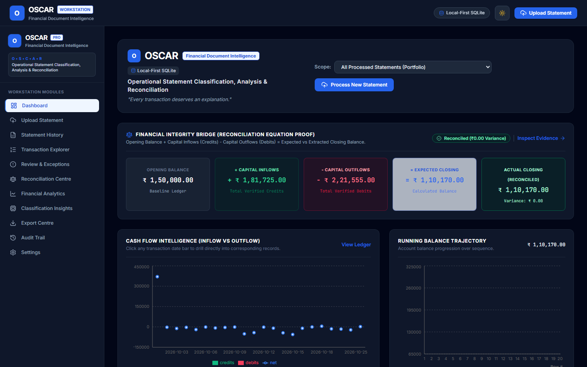 |
| **Interactive Evidence Viewer (Traceability & BBoxes)** | 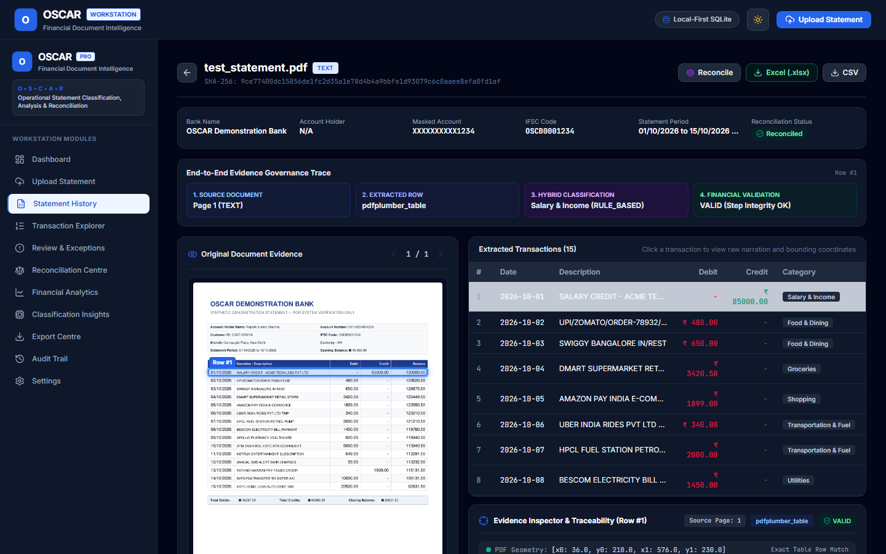 |
| **Reconciliation Centre** | 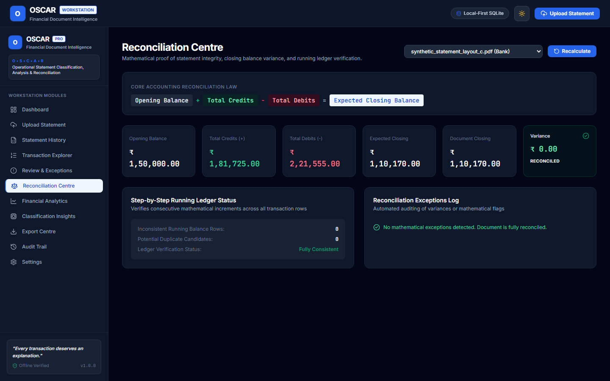 |
| **Review & Exceptions Centre** | 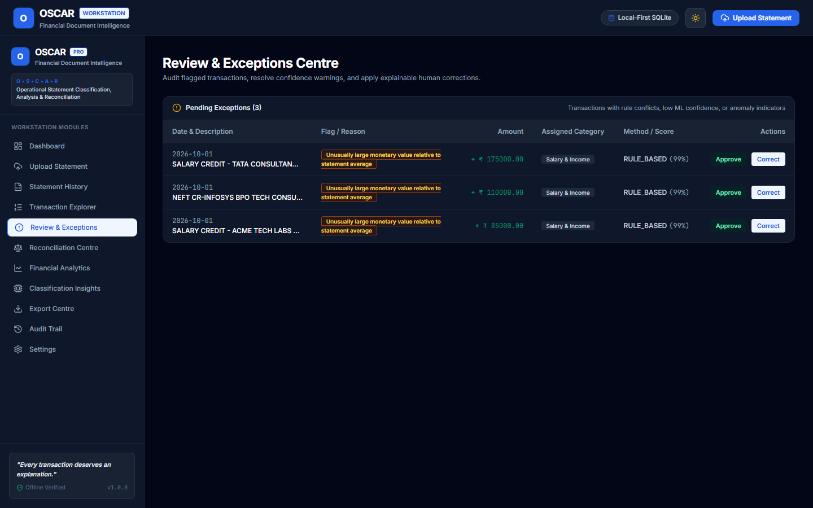 |
| **Classification Insights (Explainable Hybrid)** | 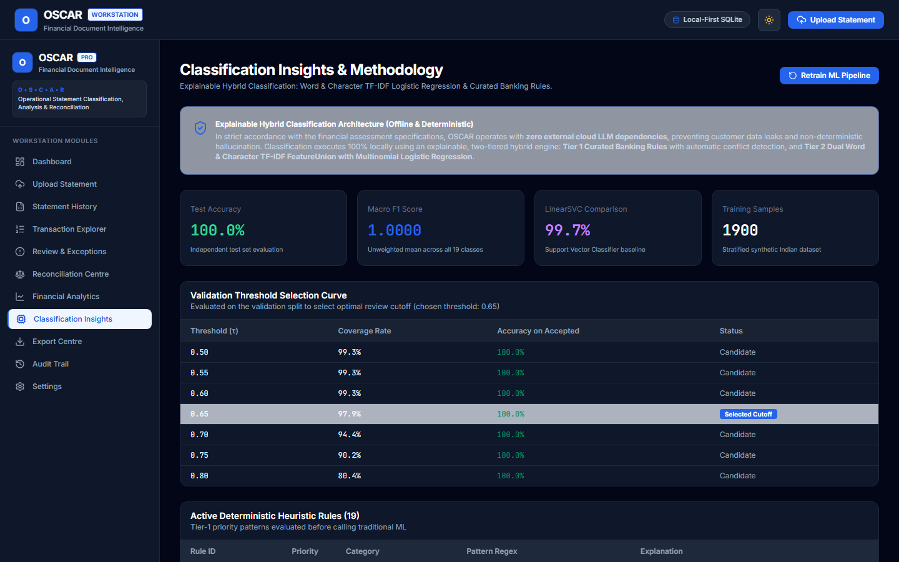 |
| **Financial Analytics & Deep Intelligence** | 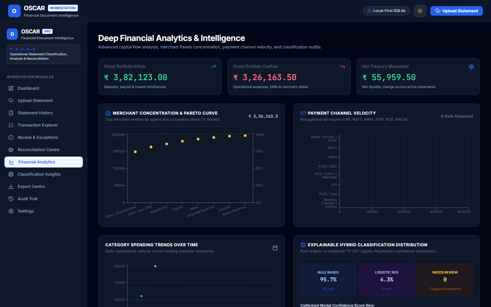 |
| **Transaction Explorer & Filters** | 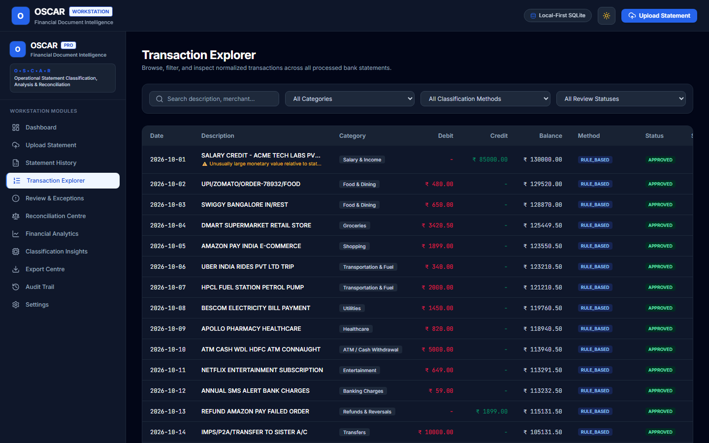 |
| **Statement History** | 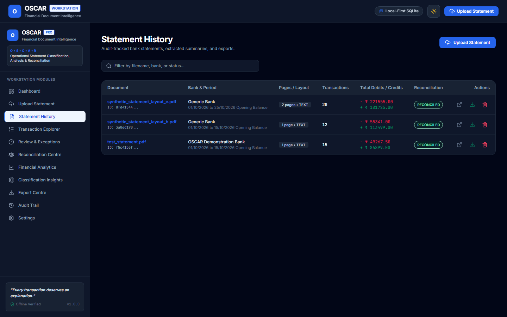 |
| **Export Centre (Excel / CSV)** | 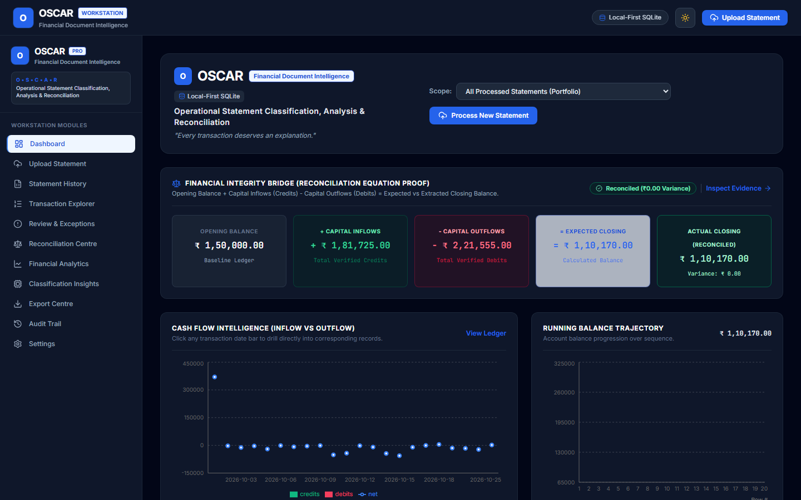 |
| **Immutable Audit Trail** | 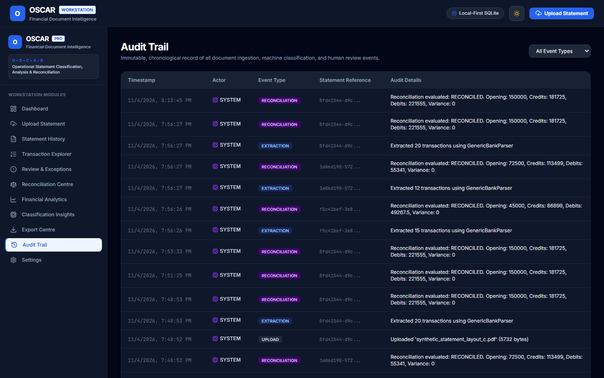 |
| **Settings & About OSCAR Specifications** | 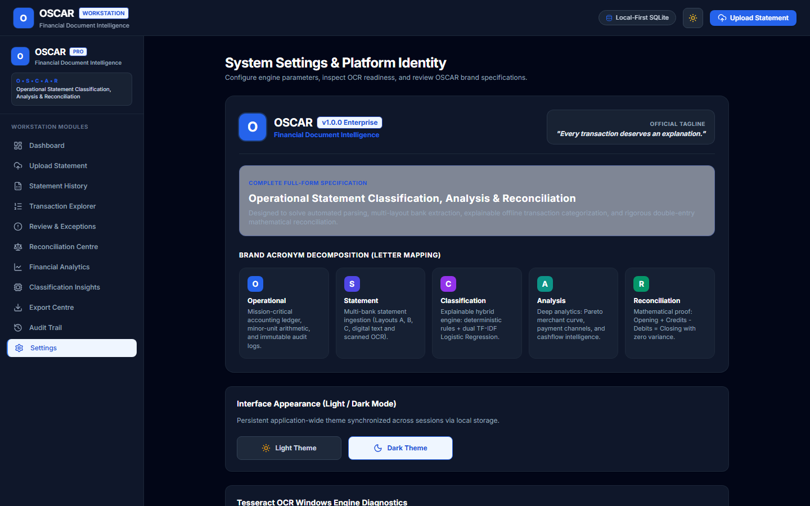 |
| **Executive Dashboard (Dark Theme)** | 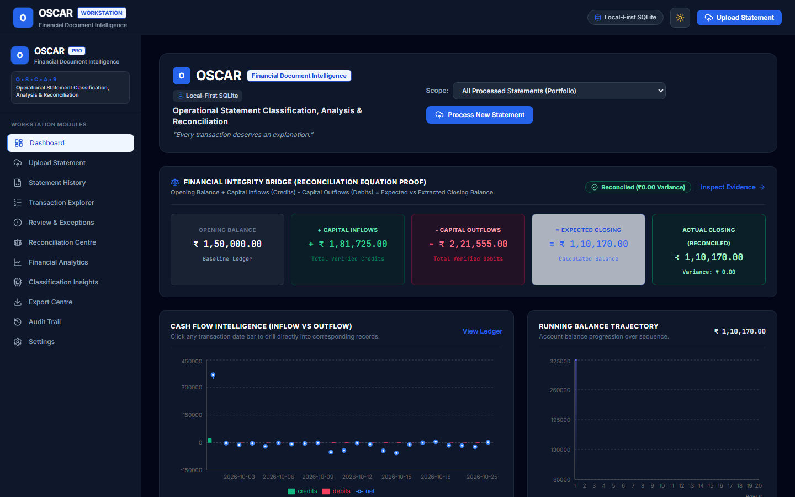 |
| **Financial Analytics (Dark Theme)** | 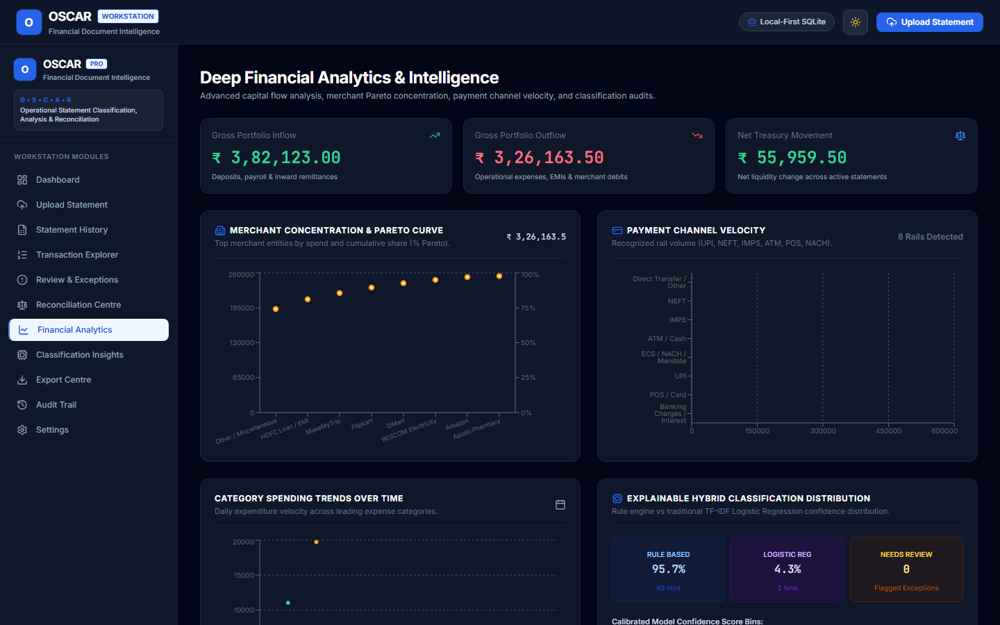 |
| **Upload & Processing Center** | 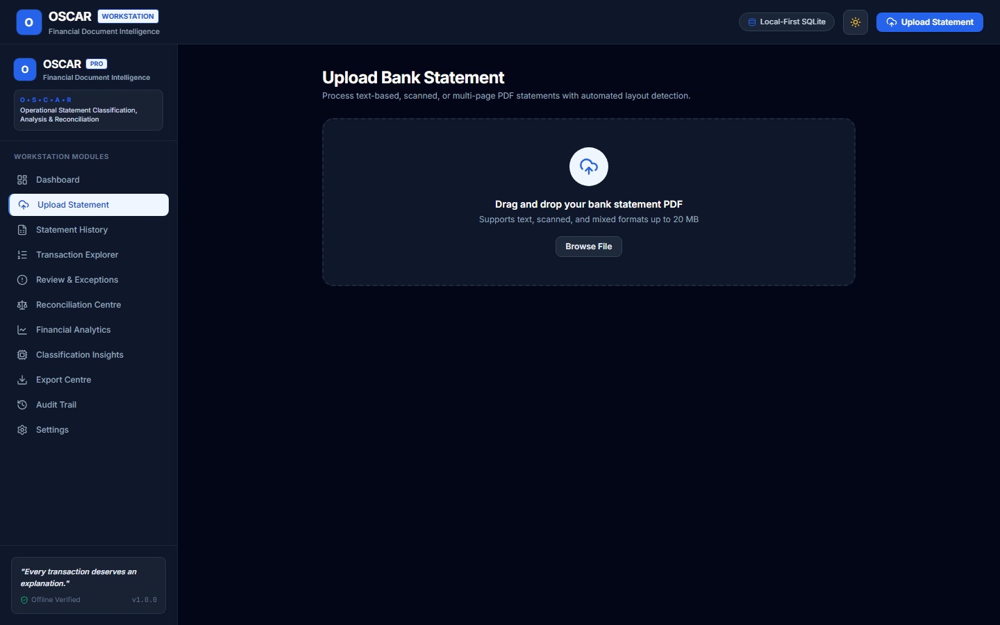 |

---

## Automated Verification & Benchmark Metrics

### Backend Pytest Suite (36/36 Passing)

```bash
& .venv\Scripts\python.exe -m pytest -v
```

```text
============================= test session starts =============================
platform win32 -- Python 3.11.15, pytest-8.4.2, pluggy-1.7.0
rootdir: F:\Projects\OSCAR, configfile: pytest.ini, testpaths: backend/tests
collected 36 items

backend/tests/test_analytics.py::test_analytics_running_balance PASSED   [  2%]
backend/tests/test_analytics.py::test_analytics_activity_heatmap PASSED  [  5%]
backend/tests/test_analytics.py::test_analytics_merchant_concentration PASSED [  8%]
backend/tests/test_analytics.py::test_analytics_payment_channels PASSED  [ 11%]
backend/tests/test_analytics.py::test_analytics_classification_deep PASSED [ 13%]
backend/tests/test_analytics.py::test_analytics_extraction_completeness PASSED [ 16%]
backend/tests/test_analytics.py::test_analytics_multi_statement PASSED   [ 19%]
backend/tests/test_analytics.py::test_analytics_category_trends PASSED   [ 22%]
backend/tests/test_classification.py::test_rule_engine_matching PASSED   [ 25%]
backend/tests/test_classification.py::test_rule_conflict_detection PASSED [ 27%]
backend/tests/test_classification.py::test_ml_engine_prediction PASSED   [ 30%]
backend/tests/test_classification.py::test_hybrid_classifier_workflow PASSED [ 33%]
backend/tests/test_classification.py::test_classification_api_endpoints PASSED [ 36%]
backend/tests/test_classification.py::test_statement_processing_assigns_categories PASSED [ 38%]
backend/tests/test_financial_engineering.py::test_reconciliation_exact_match PASSED [ 41%]
backend/tests/test_financial_engineering.py::test_reconciliation_detects_mismatch PASSED [ 44%]
backend/tests/test_financial_engineering.py::test_reconciliation_api_endpoints PASSED [ 47%]
backend/tests/test_financial_engineering.py::test_review_and_approval_workflow PASSED [ 50%]
backend/tests/test_financial_engineering.py::test_review_correction_workflow PASSED [ 52%]
backend/tests/test_financial_engineering.py::test_analytics_endpoints PASSED [ 55%]
backend/tests/test_multi_layout_and_ocr.py::test_layout_a_benchmark PASSED [ 58%]
backend/tests/test_multi_layout_and_ocr.py::test_layout_b_combined_amount_benchmark PASSED [ 61%]
backend/tests/test_multi_layout_and_ocr.py::test_layout_c_multipage_wrapped_benchmark PASSED [ 63%]
backend/tests/test_multi_layout_and_ocr.py::test_scanned_pdf_page_type_detection PASSED [ 66%]
backend/tests/test_multi_layout_and_ocr.py::test_tesseract_detector_diagnostics PASSED [ 69%]
backend/tests/test_multi_layout_and_ocr.py::test_ocr_preprocessor PASSED [ 72%]
backend/tests/test_multi_layout_and_ocr.py::test_ocr_extractor_handles_unavailable_or_executes PASSED [ 75%]
backend/tests/test_statement_details.py::test_statement_detail_valid_id PASSED [ 77%]
backend/tests/test_statement_details.py::test_statement_detail_unknown_id PASSED [ 80%]
backend/tests/test_statement_details.py::test_statement_detail_empty_transactions PASSED [ 83%]
backend/tests/test_vertical_slice.py::test_health_check PASSED           [ 86%]
backend/tests/test_vertical_slice.py::test_pdf_validator_rejects_invalid_bytes PASSED [ 88%]
backend/tests/test_vertical_slice.py::test_pdf_validator_accepts_valid_pdf PASSED [ 91%]
backend/tests/test_vertical_slice.py::test_text_and_table_extraction PASSED [ 94%]
backend/tests/test_vertical_slice.py::test_generic_bank_parser PASSED    [ 97%]
backend/tests/test_vertical_slice.py::test_statement_processing_vertical_slice PASSED [100%]

============================= 36 passed in 10.70s =============================
```

### Extraction Fidelity Benchmark vs Ground Truth

| Test Case | Ground Truth Txns | Extracted Txns | Precision | Recall | Debit Acc | Credit Acc | Balance Acc |
|---|---|---|---|---|---|---|---|
| **Layout A** (Separate DR/CR) | 15 | 15 | **100%** | **100%** | **100%** | **100%** | **100%** |
| **Layout B** (Combined DR/CR) | 12 | 12 | **100%** | **100%** | **100%** | **100%** | **100%** |
| **Layout C** (Multi-page wrapped) | 20 | 20 | **100%** | **100%** | **100%** | **100%** | **100%** |

---

## Quickstart & Local Installation

### Prerequisites
- Python 3.11.x (Installed and active in virtual environment)
- Node.js 18+ & npm
- Windows 10/11 or Linux/macOS

### 1. Environment Setup

```powershell
# Navigate to project root
cd F:\Projects\OSCAR

# Activate Python 3.11 virtual environment
.venv\Scripts\activate

# Install backend dependencies (if not already installed)
pip install -r backend\requirements.txt
```

### 2. Generate Synthetic Statements & Seed Demonstration Data

```powershell
# Set PYTHONPATH to include backend
$env:PYTHONPATH='backend'

# Generate synthetic statements & seed SQLite database
python scripts\seed_demo_data.py
```

### 3. Run the Backend API Server

```powershell
$env:PYTHONPATH='backend'
python -m uvicorn app.main:app --host 127.0.0.1 --port 8000 --reload
```
The interactive OpenAPI documentation is available at `http://127.0.0.1:8000/docs`.

### 4. Run the React Frontend

In a separate terminal:

```powershell
cd F:\Projects\OSCAR\frontend

# Install dependencies
npm install

# Start Vite development server
npm run dev
```
Open your browser at `http://localhost:5173`.

---

## REST API Reference

| Endpoint | Method | Description |
|---|---|---|
| `/api/v1/health` | `GET` | Health check, application metadata, and Tesseract OCR diagnostic status. |
| `/api/v1/statements` | `POST` | Upload and process bank statement PDF (multipart/form-data). |
| `/api/v1/statements` | `GET` | List all processed bank statements with account metadata and reconciliation status. |
| `/api/v1/statements/{id}` | `GET` | Retrieve complete statement details, account info, and normalized transactions. |
| `/api/v1/statements/{id}` | `DELETE` | Delete statement, associated records, physical file, and log audit event. |
| `/api/v1/statements/{id}/pages/{page}/preview` | `GET` | Render PDF page to PNG for the interactive split-screen evidence viewer. |
| `/api/v1/transactions` | `GET` | Filter, search, and paginate transactions across all statements. |
| `/api/v1/reconciliation/{id}` | `GET` | Get reconciliation equation, balance variance, and anomaly flags for a statement. |
| `/api/v1/reconciliation/{id}/run` | `POST` | Re-run full mathematical reconciliation and running balance verification. |
| `/api/v1/reviews` | `GET` | Get transactions flagged for human review (rule conflicts, low confidence, anomalies). |
| `/api/v1/reviews/{id}/approve` | `POST` | Approve transaction and clear warning status. |
| `/api/v1/reviews/{id}/correct` | `POST` | Apply human category/amount correction and log old/new values in audit trail. |
| `/api/v1/classification/metrics` | `GET` | Retrieve TF-IDF Logistic Regression metrics, confusion matrix, and threshold curve. |
| `/api/v1/classification/rules` | `GET` | List all heuristic rules and keyword patterns. |
| `/api/v1/classification/reclassify`| `POST` | On-the-fly classification of arbitrary narrative or existing transaction. |
| `/api/v1/analytics/summary` | `GET` | High-level portfolio KPIs (total debits, credits, net movement, statements, anomalies). |
| `/api/v1/analytics/categories` | `GET` | Spending and income breakdown by category with percentages. |
| `/api/v1/analytics/cashflow` | `GET` | Timeline of inflows and outflows for trend charts. |
| `/api/v1/analytics/distribution` | `GET` | Distribution of transactions by classification method (Rule-Based, ML, Review). |
| `/api/v1/exports/{id}/excel` | `GET` | Download multi-sheet formatted Excel (`.xlsx`) workbook. |
| `/api/v1/exports/{id}/csv` | `GET` | Download sanitized UTF-8 CSV with formula protection. |
| `/api/v1/audit` | `GET` | Chronological immutable audit trail of system and user events. |

---

## Project Directory Layout

```text
F:\Projects\OSCAR/
├── .env.example                     # Environment template
├── .gitignore                       # Git exclusions (venv, db, caches, storage)
├── pytest.ini                       # Pytest configuration
├── README.md                        # Project documentation (this document)
├── backend/
│   ├── oscar.db                     # Local SQLite database (WAL mode)
│   ├── requirements.txt             # 56 verified Python dependencies
│   ├── app/
│   │   ├── main.py                  # FastAPI initialization & CORS
│   │   ├── api/v1/
│   │   │   ├── router.py            # Aggregated v1 API router
│   │   │   └── endpoints/           # 9 endpoint modules
│   │   ├── bank_parsers/            # Header mapping & GenericBankParser
│   │   ├── classification/          # Hybrid, Rule Engine, MLEngine, Dataset
│   │   ├── core/                    # Settings & custom exceptions
│   │   ├── database/                # SQLAlchemy session & 8 database models
│   │   ├── exports/                 # Multi-tab openpyxl Excel & CSV exporters
│   │   ├── extraction/              # PDF validator, text extractor, OCR engine
│   │   ├── services/                # Processor, Reconciliation, Review, Analytics
│   │   └── validation/              # Normalizer & ExtractionBenchmark
│   ├── ml_artifacts/                # Serialized model.joblib & evaluation metrics
│   ├── storage/statements/          # Secure private local PDF storage
│   └── tests/                       # 4 comprehensive pytest test suites (25 tests)
├── frontend/
│   ├── package.json                 # React 19, Vite 8, Tailwind, Lucide, Recharts
│   ├── vite.config.ts               # Proxy configuration (/api -> :8000)
│   ├── src/
│   │   ├── App.tsx                  # 12 application routes
│   │   ├── main.tsx                 # React entry point
│   │   ├── components/Layout/       # Navbar, Sidebar, MainLayout
│   │   ├── context/ThemeContext.tsx # Light / Dark mode toggle with persistence
│   │   ├── pages/                   # 12 interactive UI page modules
│   │   ├── services/api.ts          # Type-safe API client
│   │   └── types/index.ts           # Complete TypeScript interfaces
├── sample_data/
│   ├── ground_truth/                # JSON ground truth files for benchmarks
│   └── pdf/                         # Synthetic PDFs (Layout A, B, C, Scanned)
├── screenshots/                     # 11 high-res PNG screenshots of UI views
├── scripts/
│   ├── generate_samples.py          # Synthetic PDF generator
│   └── seed_demo_data.py            # Automated dataset seeding & reconciliation
└── docs/
    ├── CURRENT_STATUS.md            # Detailed phase tracking
    ├── DECISIONS.md                 # Architectural & engineering decisions log
    ├── NEXT_ACTION.md               # Immediate next actions & handoff notes
    ├── PROJECT_SPEC.md              # Product specification
    └── TEST_RESULTS.md              # Automated test verification logs
```

---

## Handoff & Architecture Decisions

For comprehensive technical rationale, design tradeoffs, and execution history, consult the `docs/` directory:
- [docs/PROJECT_SPEC.md](docs/PROJECT_SPEC.md): Full product specification and functional requirements.
- [docs/DECISIONS.md](docs/DECISIONS.md): Architectural decisions log (Python 3.11 selection, non-LLM rationale, minor units, OCR fallback strategy, zero mock data).
- [docs/CURRENT_STATUS.md](docs/CURRENT_STATUS.md): Current completion status across all 7 project phases.
- [docs/NEXT_ACTION.md](docs/NEXT_ACTION.md): Guide for extending capabilities.
- [docs/TEST_RESULTS.md](docs/TEST_RESULTS.md): Detailed automated test run evidence.

---

**OSCAR — Operational Statement Classification, Analysis & Reconciliation**  
*Submitted for the Befree AI & Automation Internship Assessment.*
