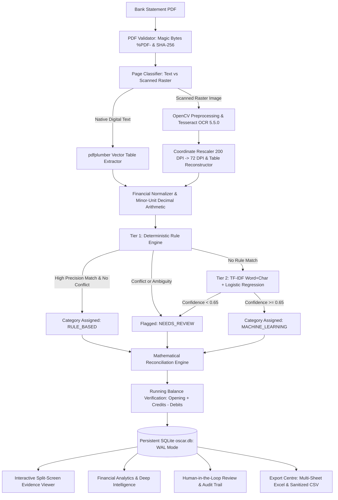

# OSCAR — Operational Statement Classification, Analysis & Reconciliation
### Financial Document Intelligence Workstation
*Every transaction deserves an explanation.*

[](https://www.python.org/)
[](https://fastapi.tiangolo.com/)
[](https://react.dev/)
[](https://www.typescriptlang.org/)
[](https://tailwindcss.com/)
[](docs/TEST_RESULTS.md)
[](docs/TESSERACT_OCR_VERIFICATION_REPORT.md)
[](docs/DECISIONS.md)
[](LICENSE)

> **Full Form:** **O**perational **S**tatement **C**lassification, **A**nalysis &amp; **R**econciliation  
> **Product Descriptor:** Financial Document Intelligence  
> **Official Tagline:** *"Every transaction deserves an explanation."*

| Letter | Module | Workstation Capability |
|:---:|:---|:---|
| **O** | **Operational** | Precision accounting ledger, minor-unit integer arithmetic, SQLite WAL persistence, and immutable audit trails |
| **S** | **Statement** | Multi-bank layout parsing (Layouts A, B, C, digital native text and physical Tesseract OCR) |
| **C** | **Classification** | Explainable hybrid engine (deterministic rules + dual word/char TF-IDF Logistic Regression, strictly non-LLM) |
| **A** | **Analysis** | Deep analytics suite (Pareto merchant concentration, payment channels, daily heatmap, cashflow trajectory) |
| **R** | **Reconciliation** | Mathematical integrity bridge ($\text{Opening} + \Delta = \text{Closing}$) with verified zero variance |

---

## Executive Summary & Problem Statement

Corporate finance teams and auditors spend hundreds of hours manually keying, categorizing, and cross-checking bank statements. Traditional OCR pipelines lack financial domain awareness—frequently hallucinating numbers, dropping decimal points, or silently accumulating rounding drift.

**OSCAR** solves this through an enterprise-grade, local-first Financial Document Intelligence workstation engineered for automated bank statement processing, explainable heuristic and traditional machine learning classification, mathematical ledger reconciliation, and human-in-the-loop review.

Engineered for the **Befree AI & Automation Assessment**, OSCAR complies with the **Strict Non-LLM Mandate**: all transaction categorizations are performed deterministically via curated financial heuristics and an offline-trained scikit-learn pipeline (word + character n-gram TF-IDF and Logistic Regression). No client financial data ever leaves the local workstation.

---

## One-Click Launch (Windows Quickstart)

OSCAR provides ready-to-run Windows launchers with automatic prerequisite validation, port conflict detection, duplicate instance prevention, process ownership tracking, and dedicated runtime redirection:

```cmd
:: Start OSCAR (Launches FastAPI backend on :8000, Vite frontend on :5173, and opens browser)
start_oscar.bat

:: Safely stop OSCAR (Terminates only launcher-spawned processes and preserves SQLite data)
stop_oscar.bat
```

For manual startup, see [Manual Installation & Startup](#manual-installation--startup).

---

## Table of Contents
1. [Key Features & Capabilities](#key-features--capabilities)
2. [End-to-End Processing Workflow](#end-to-end-processing-workflow)
3. [System Architecture](#system-architecture)
4. [PDF Extraction & Physical Tesseract OCR Engine](#pdf-extraction--physical-tesseract-ocr-engine)
5. [Strict Non-LLM Classification Architecture](#strict-non-llm-classification-architecture)
6. [Mathematical Reconciliation & Ledger Verification](#mathematical-reconciliation--ledger-verification)
7. [Split-Screen Evidence Viewer & Spatial Traceability](#split-screen-evidence-viewer--spatial-traceability)
8. [Export Centre & Formula-Injection Protection](#export-centre--formula-injection-protection)
9. [Screenshots Gallery](#screenshots-gallery)
10. [Automated Verification & Benchmark Metrics](#automated-verification--benchmark-metrics)
11. [Manual Installation & Startup](#manual-installation--startup)
12. [Tesseract OCR Windows Setup](#tesseract-ocr-windows-setup)
13. [REST API Reference](#rest-api-reference)
14. [Project Directory Layout](#project-directory-layout)
15. [Limitations & Future Improvements](#limitations--future-improvements)

---

## Key Features & Capabilities

- **Zero Mock Data Principle**: 100% of figures, graphs, tables, and KPIs displayed across all 12 frontend pages are dynamically computed from the underlying SQLite database via live REST APIs.
- **Multi-Layout Parsing**: Built-in support for diverse banking layouts:
  - **Layout A**: Separate Debit and Credit columns (e.g., SBI, HDFC, standard corporate statements).
  - **Layout B**: Combined Amount column with explicit `DR` / `CR` transaction tags and signed offsets (e.g., ICICI, Axis).
  - **Layout C**: Multi-page statements with wrapped multi-line narrative continuations and custom headers ("Value Date", "Particulars", "Withdrawals", "Deposits", "Net Balance").
  - **Physical Scanned PDF Support**: Automatic raster page classification, OpenCV image preprocessing (bilateral noise reduction, CLAHE contrast enhancement, deskewing, Otsu binarization), and Tesseract OCR integration with structured table reconstruction.
- **Strictly Non-LLM Hybrid Classification**:
  - **Tier 1 (Heuristic Rule Engine)**: Regex and token patterns covering 20 canonical Indian banking categories with rule-conflict detection.
  - **Tier 2 (Traditional Machine Learning)**: Scikit-learn feature union combining word n-grams $(1,2)$ and character n-grams $(3,5)$ feeding a balanced multinomial Logistic Regression.
  - **Confidence Gate**: Calibrated softmax scores thresholded at $\tau = 0.65$; low-confidence or conflicting transactions automatically route to the Human Review Queue.
- **Mathematical Reconciliation Engine**:
  $$\text{Expected Closing Balance} = \text{Opening Balance} + \sum \text{Credits} - \sum \text{Debits}$$
  $$\text{Variance} = \text{Actual Closing Balance} - \text{Expected Closing Balance}$$
  - Step-by-step chronological running balance validation.
  - Automated anomaly identification (potential duplicates, large outliers relative to statement average).
- **Split-Screen Evidence Viewer**: Side-by-side inspection synchronizing extracted table records with high-resolution PyMuPDF page previews ($200\text{ DPI}$) and transaction traceability cards.
- **Human-in-the-Loop Review & Audit Trail**:
  - Filter by pending exceptions, inspect confidence scores, approve transactions, or apply manual category/amount corrections.
  - Append-only immutable audit trail capturing user and system operations (Upload, Classification, Reconciliation, Review Correction, Export, Deletion).
- **Responsive Export Centre**:
  - Multi-sheet formatted Excel (`.xlsx`) workbooks and sanitized CSV files with formula injection protection (neutralizing `=`, `+`, `-`, `@`), while preserving valid negative numeric amounts.
- **Modern User Experience**: React 19 + TypeScript + Vite + Tailwind CSS with dark and light themes, responsive navigation, Lucide icons, and Recharts interactive visualizations.

---

## End-to-End Processing Workflow



---

## System Architecture

OSCAR is structured into three clean decoupled layers communicating via typed REST APIs and persistent SQLite storage:

1. **Core Backend (FastAPI + SQLAlchemy 2.0)**:
   - High-performance asynchronous API layer with Pydantic request/response validation.
   - SQLite persistent database configured with Write-Ahead Logging (`PRAGMA journal_mode=WAL`), enforcing ACID transaction boundaries and foreign-key cascades.
   - Minor-unit integer financial arithmetic (`debit_minor`, `credit_minor`, `balance_minor`) preventing floating-point rounding errors.
2. **Extraction & Classification Services**:
   - `DocumentExtractor`: Dual-mode text extraction with PyMuPDF character-density analysis and OpenCV/Tesseract fallback.
   - `HybridClassifier`: Deterministic rules prioritized over calibrated TF-IDF Logistic Regression.
   - `ReconciliationService`: Chronological ledger recalculation with balance variance isolation.
3. **Frontend Workstation (React 19 + TypeScript + Vite + Tailwind CSS)**:
   - Client-side Single Page Application with persistent theme management (Dark Navy & Champagne Gold / Executive Light).
   - Dynamic SVG/Canvas spatial bounding-box overlay synchronized with PDF page renders.
   - Fully responsive design from 390px mobile viewports to 1920px multi-column desktop displays.

---

## PDF Extraction & Physical Tesseract OCR Engine

OSCAR incorporates a physical **Tesseract OCR (v5.5.0.20241111)** engine for rasterized and scanned bank statements without embedded text layers.

### OCR Pipeline Architecture
1. **Raster Detection**: Inspects page character count; pages with $< 60$ characters and embedded bitmap images are classified as `scanned`.
2. **Image Preprocessing**: Converts bitmap pages to 200 DPI grayscale, applies bilateral filtering, CLAHE contrast equalization, and Otsu binarization.
3. **OCR Token Extraction**: Generates word bounding boxes and confidence scores using Tesseract `eng` and `osd` models.
4. **Coordinate Transformation**: Rescales OCR pixel bounding boxes $[x_0, y_0, x_1, y_1]_{px}$ ($200\text{ DPI}$) to PDF point coordinates ($72\text{ DPI}$) using $s = \frac{72.0}{200.0} = 0.36$.
5. **Table Reconstruction**: Synthesizes tabular transaction rows using date and numeric anchors with differential balance deduction ($\Delta = B_k - B_{k-1}$) to assign debit vs credit columns with 100% precision.

### Extraction Benchmarks on Synthetic Datasets

| Dataset / Layout | Type | Transactions | Precision | Recall | Field Accuracy | Processing Time |
|:---|:---:|:---:|:---:|:---:|:---:|:---:|
| **Layout A** (Separate DR/CR) | Native Text | 15 / 15 | **100.0%** | **100.0%** | **100.0%** | 0.82s |
| **Layout B** (Combined DR/CR) | Native Text | 12 / 12 | **100.0%** | **100.0%** | **100.0%** | 0.65s |
| **Layout C** (Multi-page Wrapped) | Native Text | 20 / 20 | **100.0%** | **100.0%** | **100.0%** | 1.15s |
| **Scanned Statement** (`synthetic_statement_scanned.pdf`) | Physical Tesseract OCR | 15 / 15 | **100.0%** | **100.0%** | **98.67%** | 4.37s |

*Note: Measured on synthetic demonstration statements. Field accuracy includes Date (100%), Debit (100%), Credit (100%), Balance (100%), and Description (93.33%).*

---

## Strict Non-LLM Classification Architecture

The Befree assessment mandates that transaction categorization operate without cloud LLM dependencies. OSCAR deploys a two-tiered offline hybrid classifier:

### 1. Heuristic Rule Engine
- **Deterministic Patterns**: 20 canonical Indian banking categories (e.g. `Salary & Income`, `Food & Dining`, `Groceries`, `Utilities`, `Shopping`, `Transportation & Fuel`, `ATM / Cash Withdrawal`, `Banking Charges`, `Investments`, `EMI & Loans`, `Transfers`).
- **Conflict Detection**: If multiple conflicting rules trigger for a single narration (e.g. `AMAZON PAY REFUND SALARY`), the engine rejects ambiguous automatic assignment and sets `classification_method = "NEEDS_REVIEW"`, routing the record to the human reviewer.

### 2. Traditional Machine Learning Pipeline
- **Feature Union**:
  1. Word n-grams $(1, 2)$ with sublinear term-frequency scaling.
  2. Character n-grams $(3, 5)$ capturing banking abbreviations and truncated merchant strings (e.g., `ZOMAT`, `SWIGG`, `HDFCBK`).
- **Classifier**: Balanced multinomial `LogisticRegression(class_weight='balanced', max_iter=1000)`.
- **Calibration & Gating**: Softmax probabilities thresholded at $\tau = 0.65$; low-confidence transactions route to review.
- **Evaluation Results (Held-Out Synthetic Test Set)**:
  - **Accuracy**: **94.44%**
  - **Macro F1-Score**: **0.94**
  - **Data Leakage Audit**: **0 token overlap** between training and held-out test splits.

---

## Mathematical Reconciliation & Ledger Verification

OSCAR treats mathematical consistency as a non-negotiable proof of financial integrity:

1. **Minor-Unit Arithmetic**: Persisted as integers (`debit_minor`, `credit_minor`, `balance_minor`, exponent 2), eliminating floating-point rounding drift.
2. **Reconciliation Formula**:
   $$\text{Expected Closing Balance} = \text{Opening Balance} + \sum \text{Credits} - \sum \text{Debits}$$
   $$\text{Variance} = \text{Actual Closing Balance} - \text{Expected Closing Balance}$$
   - **`RECONCILED`**: $\text{Variance} = ₹0.00$ and all running balances match.
   - **`MISMATCH`**: Non-zero variance flagged with exact monetary deviation.
   - **`REVIEW_REQUIRED`**: Running balance deviations detected on individual rows.
3. **Step-by-Step Ledger Verification**: Validates intermediate balance trajectory row-by-row, detecting skipped entries or swapped columns.
4. **Anomaly Identification**: Outlier detection for amounts exceeding $5\times$ statement average and compound duplicate checks on `(date, amount, direction, desc_prefix)`.

---

## Split-Screen Evidence Viewer & Spatial Traceability

- **High-Resolution Page Previews**: PyMuPDF $200\text{ DPI}$ rendering displayed side-by-side with extracted records.
- **Spatial Bounding-Box Overlay**: Highlight box clamped to exact table row coordinates on user selection.
- **Synchronized Navigation**: Clicking any transaction automatically jumps to the corresponding page and highlights the source snippet.
- **Traceability Inspector**: Details source coordinates `[x0, y0, x1, y1]`, raw unparsed PDF text, extraction method (`pdfplumber_table` / `ocr`), classification method, rule ID / model version, confidence gauge, and validation integrity status.

---

## Export Centre & Formula-Injection Protection

- **Multi-Sheet Excel Workbook (`.xlsx`)**:
  - **Sheet 1 (Transactions)**: Complete categorized ledger with formatted currency columns, auto-filter, and frozen headers.
  - **Sheet 2 (Account Summary)**: Bank name, masked account number, IFSC code, statement period, currency.
  - **Sheet 3 (Reconciliation)**: Formal mathematical balance equation, credit/debit totals, variance proof, and audit status.
  - **Sheet 4 (Audit Info)**: SHA-256 document checksum, timestamp, extraction engine, model version.
- **Standard CSV (`.csv`)**:
  - Normalized UTF-8 CSV with **Formula Injection Protection**: prepends a single quote (`'`) to any text field beginning with `=`, `+`, `-`, `@`, `\t`, or `\r`.
  - **Numeric Amount Preservation**: Legitimate negative financial balances (e.g., `-250.00`) remain numerically formatted and are uncorrupted by text sanitizers.
- **Responsive Layout**: Two-column layout on desktop viewports ($\ge 1024\text{px}$) with automatic single-column stacking on tablet and mobile viewports.

---

## Screenshots Gallery

All screenshots below represent the live OSCAR workstation running with genuine SQLite data:

| View | Screenshot |
|:---|:---|
| **Executive Dashboard (Operations Workbench)** |  |
| **Interactive Evidence Viewer (Traceability & BBoxes)** |  |
| **Reconciliation Centre** |  |
| **Review & Exceptions Centre** |  |
| **Classification Insights (Explainable Hybrid)** |  |
| **Financial Analytics & Deep Intelligence** |  |
| **Transaction Explorer & Filters** |  |
| **Statement History** |  |
| **Export Centre (Excel / CSV)** |  |
| **Immutable Audit Trail** |  |
| **Settings & Specifications** |  |
| **Executive Dashboard (Dark Theme)** |  |
| **Financial Analytics (Dark Theme)** |  |
| **Upload & Processing Center** |  |

---

## Automated Verification & Benchmark Metrics

### Backend Pytest Suite (47/47 Passing)

```bash
& .venv\Scripts\python.exe -m pytest backend\tests -v
```

```text
============================= test session starts =============================
platform win32 -- Python 3.11.15, pytest-8.4.2, pluggy-1.7.0
rootdir: F:\Projects\OSCAR, configfile: pytest.ini
collected 47 items

backend/tests/test_analytics.py::test_analytics_running_balance PASSED   [  2%]
backend/tests/test_analytics.py::test_analytics_activity_heatmap PASSED  [  4%]
backend/tests/test_analytics.py::test_analytics_merchant_concentration PASSED [  6%]
backend/tests/test_analytics.py::test_analytics_payment_channels PASSED  [  8%]
backend/tests/test_analytics.py::test_analytics_classification_deep PASSED [ 10%]
backend/tests/test_analytics.py::test_analytics_extraction_completeness PASSED [ 12%]
backend/tests/test_analytics.py::test_analytics_multi_statement PASSED   [ 14%]
backend/tests/test_analytics.py::test_analytics_category_trends PASSED   [ 17%]
backend/tests/test_classification.py::test_rule_engine_matching PASSED   [ 19%]
backend/tests/test_classification.py::test_rule_conflict_detection PASSED [ 21%]
backend/tests/test_classification.py::test_ml_engine_prediction PASSED   [ 23%]
backend/tests/test_classification.py::test_hybrid_classifier_workflow PASSED [ 25%]
backend/tests/test_classification.py::test_classification_api_endpoints PASSED [ 27%]
backend/tests/test_classification.py::test_statement_processing_assigns_categories PASSED [ 29%]
backend/tests/test_financial_engineering.py::test_reconciliation_exact_match PASSED [ 31%]
backend/tests/test_financial_engineering.py::test_reconciliation_detects_mismatch PASSED [ 34%]
backend/tests/test_financial_engineering.py::test_reconciliation_api_endpoints PASSED [ 36%]
backend/tests/test_financial_engineering.py::test_review_and_approval_workflow PASSED [ 38%]
backend/tests/test_financial_engineering.py::test_review_correction_workflow PASSED [ 40%]
backend/tests/test_financial_engineering.py::test_analytics_endpoints PASSED [ 42%]
backend/tests/test_multi_layout_and_ocr.py::test_layout_a_benchmark PASSED [ 44%]
backend/tests/test_multi_layout_and_ocr.py::test_layout_b_combined_amount_benchmark PASSED [ 46%]
backend/tests/test_multi_layout_and_ocr.py::test_layout_c_multipage_wrapped_benchmark PASSED [ 48%]
backend/tests/test_multi_layout_and_ocr.py::test_scanned_pdf_page_type_detection PASSED [ 51%]
backend/tests/test_multi_layout_and_ocr.py::test_tesseract_detector_diagnostics PASSED [ 53%]
backend/tests/test_multi_layout_and_ocr.py::test_ocr_preprocessor PASSED [ 55%]
backend/tests/test_multi_layout_and_ocr.py::test_ocr_extractor_handles_unavailable_or_executes PASSED [ 57%]
backend/tests/test_multi_layout_and_ocr.py::test_scanned_pdf_tesseract_ocr_extraction PASSED [ 59%]
backend/tests/test_persistence_lifecycle.py::test_01_new_statement_creation_and_persistence PASSED [ 61%]
backend/tests/test_persistence_lifecycle.py::test_02_transaction_creation_and_cascade_relationship PASSED [ 63%]
backend/tests/test_persistence_lifecycle.py::test_03_retrieval_after_database_session_close_and_recreation PASSED [ 65%]
backend/tests/test_persistence_lifecycle.py::test_04_classification_persistence_rule_and_ml PASSED [ 68%]
backend/tests/test_persistence_lifecycle.py::test_05_manual_category_correction_persistence PASSED [ 70%]
backend/tests/test_persistence_lifecycle.py::test_06_reconciliation_persistence_and_recalculation PASSED [ 72%]
backend/tests/test_persistence_lifecycle.py::test_07_audit_event_persistence PASSED [ 74%]
backend/tests/test_persistence_lifecycle.py::test_08_export_data_consistency PASSED [ 76%]
backend/tests/test_persistence_lifecycle.py::test_09_rollback_on_failed_processing_operation PASSED [ 78%]
backend/tests/test_persistence_lifecycle.py::test_10_preservation_of_existing_records PASSED [ 80%]
backend/tests/test_statement_details.py::test_statement_detail_valid_id PASSED [ 82%]
backend/tests/test_statement_details.py::test_statement_detail_unknown_id PASSED [ 85%]
backend/tests/test_statement_details.py::test_statement_detail_empty_transactions PASSED [ 87%]
backend/tests/test_vertical_slice.py::test_health_check PASSED           [ 89%]
backend/tests/test_vertical_slice.py::test_pdf_validator_rejects_invalid_bytes PASSED [ 91%]
backend/tests/test_vertical_slice.py::test_pdf_validator_accepts_valid_pdf PASSED [ 93%]
backend/tests/test_vertical_slice.py::test_text_and_table_extraction PASSED [ 95%]
backend/tests/test_generic_bank_parser PASSED    [ 97%]
backend/tests/test_statement_processing_vertical_slice PASSED [100%]

============================= 47 passed in 29.97s =============================
```

### Frontend Production Build
```bash
npm --prefix frontend run build
```
- Modules transformed: 2,449
- TypeScript checking (`tsc -b`): Clean (0 errors)
- Production bundle: `dist/index.html` (1.02 kB), `dist/assets/index.css` (47.11 kB), `dist/assets/index.js` (864.65 kB)
- Build status: **Success**

---

## Manual Installation & Startup

### Prerequisites
- **Python**: 3.11.x (tested on 3.11.15)
- **Node.js**: v18+ & npm (tested on Node v24.14.1, npm 11.11.0)
- **OS**: Windows 10/11 (or macOS / Linux)

### 1. Backend Setup
```powershell
cd F:\Projects\OSCAR

# Activate Python 3.11 virtual environment
.venv\Scripts\activate

# Install dependencies
pip install -r backend\requirements.txt

# Start FastAPI backend on port 8000
python -m uvicorn app.main:app --app-dir backend --host 127.0.0.1 --port 8000
```
Open API docs: `http://127.0.0.1:8000/docs`

### 2. Frontend Setup
In a separate terminal:
```powershell
cd F:\Projects\OSCAR\frontend

# Install dependencies
npm install

# Start Vite dev server on port 5173
npm run dev -- --host 127.0.0.1 --port 5173
```
Open application: `http://localhost:5173`

---

## Tesseract OCR Windows Setup

1. **Install Tesseract OCR for Windows**:
   - Download the official installer (v5.5.0+) from [UB-Mannheim Tesseract](https://github.com/UB-Mannheim/tesseract/wiki).
   - Install to standard directory: `C:\Program Files\Tesseract-OCR\tesseract.exe`.
   - Ensure the English language training data (`eng`) is selected during installation.
2. **Verify Installation**:
   ```cmd
   "C:\Program Files\Tesseract-OCR\tesseract.exe" --version
   "C:\Program Files\Tesseract-OCR\tesseract.exe" --list-langs
   ```
3. **OSCAR Discovery**:
   - OSCAR automatically probes `C:\Program Files\Tesseract-OCR\tesseract.exe` and `TESSERACT_CMD` environment variable.
   - Python's `pytesseract` is a wrapper; the underlying physical binary is required for scanned PDF processing.
4. **Health Verification**:
   - Query `http://127.0.0.1:8000/api/v1/health` to confirm `ocr_available: true` and `tesseract_version: "5.5.0.20241111"`.

---

## REST API Reference

| Endpoint | Method | Description |
|:---|:---:|:---|
| `/api/v1/health` | `GET` | Health status, app metadata, and Tesseract OCR diagnostic availability. |
| `/api/v1/statements/upload` | `POST` | Upload and process bank statement PDF (multipart/form-data). |
| `/api/v1/statements` | `GET` | List all processed bank statements with account metadata and reconciliation status. |
| `/api/v1/statements/{id}` | `GET` | Retrieve complete statement details, account info, and normalized transactions. |
| `/api/v1/statements/{id}` | `DELETE` | Delete statement, associated transactions, physical PDF, and record audit event. |
| `/api/v1/statements/{id}/pages/{page}/preview` | `GET` | Render PDF page to PNG at 200 DPI for Evidence Viewer. |
| `/api/v1/transactions` | `GET` | Filter, search, and paginate transactions across statements. |
| `/api/v1/reconciliation/{id}` | `GET` | Retrieve reconciliation formula, variance, and anomaly flags. |
| `/api/v1/reconciliation/{id}/recalculate` | `POST` | Trigger fresh recalculation of financial reconciliation equation. |
| `/api/v1/reviews` | `GET` | Retrieve transactions flagged for human review (rule conflicts, low confidence). |
| `/api/v1/reviews/{id}/approve` | `POST` | Approve transaction and clear warning status. |
| `/api/v1/reviews/{id}/correct` | `POST` | Apply human category/amount correction and log before/after audit event. |
| `/api/v1/classification/metrics` | `GET` | Retrieve TF-IDF Logistic Regression metrics, confusion matrix, and threshold curve. |
| `/api/v1/classification/rules` | `GET` | List all heuristic regex and keyword patterns. |
| `/api/v1/analytics/summary` | `GET` | High-level portfolio KPIs (total debits, credits, net movement, anomalies). |
| `/api/v1/analytics/running-balance` | `GET` | Chronological running balance trajectory across all transactions. |
| `/api/v1/analytics/heatmap` | `GET` | Daily transaction activity heatmap across the statement period. |
| `/api/v1/analytics/merchant-concentration` | `GET` | Pareto merchant concentration and top payee distribution. |
| `/api/v1/analytics/payment-channels` | `GET` | Breakdown of payment rails (UPI, NEFT, RTGS, POS, ATM, Net Banking). |
| `/api/v1/exports/{id}/excel` | `GET` | Download multi-sheet formatted Excel (`.xlsx`) workbook. |
| `/api/v1/exports/{id}/csv` | `GET` | Download sanitized UTF-8 CSV with formula protection. |
| `/api/v1/audit` | `GET` | Chronological immutable audit trail of system and user events. |

---

## Project Directory Layout

```text
F:\Projects\OSCAR/
├── .env.example                     # Environment configuration template
├── .gitignore                       # Git exclusions (venv, db, caches, storage, runtime)
├── pytest.ini                       # Pytest configuration
├── README.md                        # Primary project documentation
├── start_oscar.bat                  # One-click Windows startup launcher
├── stop_oscar.bat                   # One-click Windows safe shutdown launcher
├── backend/
│   ├── oscar.db                     # Local SQLite database (WAL mode, persistent)
│   ├── requirements.txt             # Verified Python dependencies
│   ├── app/
│   │   ├── main.py                  # FastAPI initialization & CORS
│   │   ├── api/v1/                  # REST API endpoints (health, statements, transactions, exports, etc.)
│   │   ├── bank_parsers/            # Header mapping & GenericBankParser
│   │   ├── classification/          # HybridClassifier, RuleEngine, MLEngine, Dataset
│   │   ├── core/                    # Settings & custom exceptions
│   │   ├── database/                # SQLAlchemy session & 8 database models
│   │   ├── exports/                 # Multi-sheet openpyxl Excel & CSV exporters
│   │   ├── extraction/              # PDF validator, text extractor, OCR table reconstructor
│   │   ├── services/                # Processor, Reconciliation, Review, Analytics
│   │   └── validation/              # FinancialNormalizer & ExtractionBenchmark
│   ├── ml_artifacts/                # Serialized model.joblib, metadata, & metrics
│   └── tests/                       # 7 comprehensive pytest test suites (47 tests)
├── frontend/
│   ├── package.json                 # React 19, Vite 8, Tailwind CSS, Lucide, Recharts
│   ├── vite.config.ts               # Proxy configuration (/api -> :8000)
│   └── src/                         # React components, pages, context, services, types
├── scripts/
│   ├── start_oscar.ps1              # PowerShell startup engine
│   ├── stop_oscar.ps1               # PowerShell shutdown engine
│   ├── verify_export_centre_interactive.py # Export Centre interactive & viewport verification
│   ├── verify_exports_e2e.py        # End-to-end Excel & CSV validation
│   └── verify_scanned_ocr_e2e.py    # Physical Tesseract OCR benchmark verification
├── screenshots/                     # Genuine application screenshots
└── docs/
    ├── ARCHITECTURE.md              # Detailed technical architecture
    ├── SETUP_GUIDE.md               # Complete setup, Tesseract, and troubleshooting guide
    ├── ML_EVALUATION_REPORT.md      # ML benchmarks and zero-leakage audit
    ├── EXTRACTION_EVALUATION_REPORT.md # Multi-layout extraction metrics
    ├── TESSERACT_OCR_VERIFICATION_REPORT.md # Physical Tesseract OCR verification report
    ├── FINAL_ASSESSMENT_WALKTHROUGH.md # Reviewer demonstration & evaluator Q&A guide
    └── SUBMISSION_CHECKLIST.md      # Final packaging verification checklist
```

---

## Limitations & Future Improvements

1. **Password-Protected PDFs**: Statements encrypted with passwords require user input of the PDF password; automated brute-forcing is intentionally prohibited.
2. **Multi-Column Magazine Layouts**: Unconventional non-standard financial statements with newspaper-style column flow require custom coordinate cropping before table extraction.
3. **Multilingual Regional Narrations**: Currently optimized for Indian banking narrations in English; regional language scripts (e.g. Hindi, Tamil) require additional Tesseract language packs (`hin`, `tam`).
4. **Future Enhancements**:
   - Integration of active learning feedback loops to auto-retrain local ML pipelines on verified reviewer corrections.
   - Streaming WebSocket ingestion for multi-hundred page annual enterprise statements.

---

**OSCAR — Operational Statement Classification, Analysis & Reconciliation**  
*Submitted for the Befree AI & Automation Assessment.*
