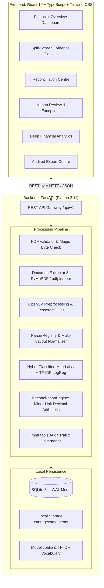
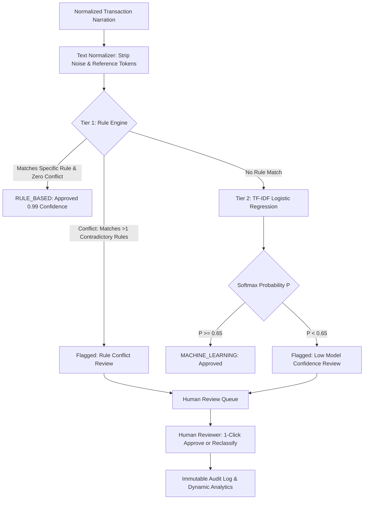

# OSCAR System Architecture & Technical Specification

**Product**: OSCAR (Operational Statement Classification, Analysis & Reconciliation)  
**Product Descriptor**: Financial Document Intelligence  
**Tagline**: *"Every transaction deserves an explanation."*  
**Architecture Model**: Air-Gapped Local-First Financial Workstation  

---

## 1. High-Level Architectural Model

OSCAR is designed as an enterprise-grade, local-first workstation for financial statement parsing, hybrid classification, mathematical reconciliation, and statutory audit reporting. It operates entirely offline without external cloud AI dependencies, ensuring absolute confidentiality for sensitive banking records.

---

## 2. Ingestion & Multi-Layout Extraction Pipeline

### 2.1 PDF Validation
All uploaded files undergo multi-stage validation in [`PDFValidator`](file:///F:/Projects/OSCAR/backend/app/extraction/pdf_validator.py):
1. **Magic Byte Verification**: Verifies the first 1024 bytes start with `%PDF-` signature.
2. **File Size Enforcement**: Caps file uploads at 50MB to prevent memory exhaustion.
3. **Integrity Hashing**: Computes SHA-256 hash for document deduplication and cryptographic audit logging.

### 2.2 Dual Text & OCR Ingestion Engine
1. **Digital PDF Extraction**: Pages with character counts $\ge 60$ are processed via `pdfplumber` and `PyMuPDF (fitz)`. Table structures are identified with explicit column boundaries, text coordinates, and font metadata.
2. **Scanned PDF Fallback**: Pages with character count $< 60$ containing raster images trigger the `OCRExtractor`:
   - Image conversion at 200 DPI.
   - OpenCV preprocessing pipeline: Bilateral filtering (noise reduction without blurring edges), CLAHE (contrast enhancement), Hough-transform skew angle estimation ($[-15^\circ, +15^\circ]$), and Otsu binarization.
   - Tesseract OCR v5 engine executes with Page Segmentation Mode 6 (`--psm 6`: assume uniform text block).
   - Word bounding boxes are normalized to standard PDF point coordinates $(72\text{ DPI})$.

### 2.3 Banking Layout Profiles
The parsing engine in [`ParserRegistry`](file:///F:/Projects/OSCAR/backend/app/bank_parsers/registry.py) dynamically matches tabular profiles:
- **Layout A (Standard Multi-Column)**: Explicit separate `Debit` and `Credit` columns with running balance (e.g., SBI, HDFC).
- **Layout B (Single Amount with Type Flag)**: Single `Amount` column with explicit `DR`/`CR` indicator flag or sign (e.g., ICICI, Axis).
- **Layout C (Multi-Page Wrapped)**: Complex statements where narrative particulars wrap across 2 to 3 visual lines and table headers repeat across page breaks (e.g., Kotak, Federal Bank).

---

## 3. Strict Non-LLM Hybrid Classification Architecture

OSCAR completely rejects cloud LLM dependencies, guaranteeing deterministic, explainable, and air-gapped performance.

### 3.1 Tier 1: Heuristic Rule Engine
- Evaluates compiled regular expressions against 19 financial categories.
- Detects salary credits, recurring utility bills, UPI merchant identifiers, loan EMIs, and statutory tax challans.
- **Conflict Prevention**: If contradictory patterns trigger for a single narration (e.g. `SALARY LOAN REPAYMENT`), the engine refuses heuristic assignment and routes the record to the human review queue.

### 3.2 Tier 2: Machine Learning Subsystem
- **Feature Pipeline**: Scikit-learn `FeatureUnion` combining:
  1. Word n-grams $(1, 2)$ with sublinear term-frequency scaling.
  2. Character n-grams $(3, 5)$ with character boundary markers (`char_wb`), capturing truncated banking codes and merchant acronyms.
- **Classifier**: Multinomial `LogisticRegression(class_weight='balanced', C=2.0)`.
- **Confidence Calibration**: Outputs softmax posterior probabilities for all 19 target classes.
- **Review Gating**: Predictions below $\tau = 0.65$ trigger `NEEDS_REVIEW`.

---

## 4. Mathematical Double-Entry Ledger Reconciliation

### 4.1 Minor-Unit Precision
All monetary operations avoid IEEE 754 binary floating-point inaccuracies by computing in Python `Decimal` and persisting as integer minor units (`paise` in INR, integer cents in USD).

### 4.2 Reconciliation Equation Proof
For every statement:
$$\text{Expected Closing Balance} = \text{Opening Balance} + \sum_{i=1}^N \text{Credits}_i - \sum_{i=1}^N \text{Debits}_i$$
$$\text{Variance} = |\text{Actual Extracted Closing Balance} - \text{Expected Closing Balance}|$$

- **Reconciled Status**: If $\text{Variance} = 0$, status is marked `RECONCILED`.
- **Discrepancy Status**: If $\text{Variance} > 0$, status is marked `DISCREPANCY` with exact variance amount displayed in red.

### 4.3 Running Balance Step Verification
For sequential transactions $i = 1 \dots N$:
$$\text{Calculated Balance}_i = \text{Balance}_{i-1} + \text{Credit}_i - \text{Debit}_i$$
Any discrepancy between extracted balance and calculated balance flags a running balance discontinuity exception.

---

## 5. Security & Statutory Export Architecture

### 5.1 Spreadsheet Formula Injection Protection (CWE-1236)
In `CSVExporter`, every string cell beginning with dangerous formula initiation characters (`=`, `+`, `-`, `@`, `\t`, `\r`) is prepended with a single quote character (`'`). This prevents malicious payloads inside transaction descriptions from executing in Microsoft Excel or LibreOffice Calc.

### 5.2 Multi-Tab Audited Excel Workbooks
`ExcelExporter` leverages `openpyxl` to produce multi-tab workbooks:
- **Sheet 1 (Summary)**: Statement metadata, opening/closing balances, reconciliation proof, variance.
- **Sheet 2 (Reconciled Ledger)**: All transactions with normalized dates, descriptions, debit, credit, balance, category, method, confidence.
- **Sheet 3 (Category Breakdown)**: Inflow and outflow distributions by taxonomy category.
- **Sheet 4 (Review & Exceptions)**: Pending exceptions and resolved overrides.
- **Sheet 5 (Audit Log)**: Full chronological audit trail.

---

## 6. Database Storage & Persistence

OSCAR utilizes SQLite 3 managed via SQLAlchemy 2.0 ORM:
- **Write-Ahead Logging (WAL)**: `PRAGMA journal_mode=WAL` enables concurrent non-blocking reads and high-throughput transactional writes.
- **Foreign Key Constraints**: `PRAGMA foreign_keys=ON` ensures relational integrity across statements, accounts, transactions, reviews, and audit trails.
