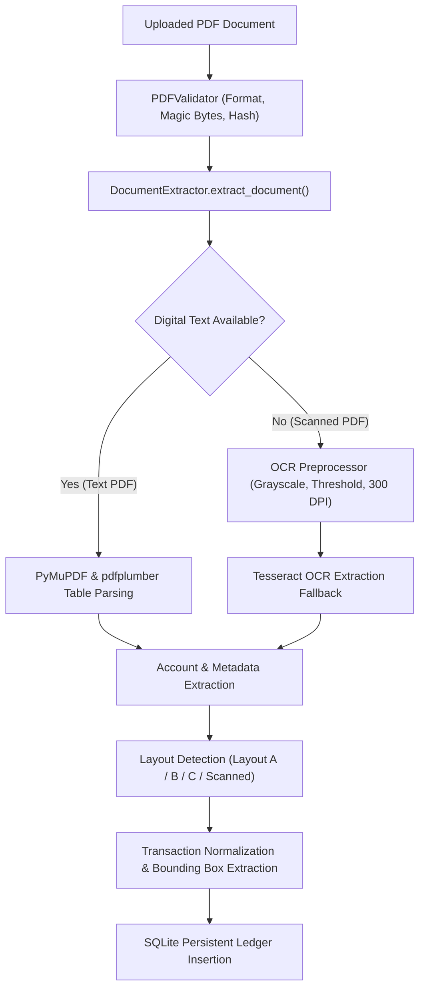

# OSCAR — Final Assessment Walkthrough & Technical Guide
## Operational Statement Classification, Analysis & Reconciliation
**Product Descriptor**: Financial Document Intelligence  
**Tagline**: *Every transaction deserves an explanation.*  
**Repository Root**: `F:\Projects\OSCAR`  
**Evaluation Date**: November 2026  

---

## 1. Executive Overview & Mission

### What OSCAR Does
**OSCAR** is an enterprise-grade, offline-capable Financial Document Intelligence platform built for financial analysts, auditors, controllers, and compliance teams. It ingests complex, unstructured bank statement PDFs across diverse multi-column and tabular layouts, extracts structured transactions with pixel-level coordinate traceability, applies a deterministic and explainable hybrid classification engine (rules + scikit-learn machine learning), executes minor-unit financial ledger reconciliation, and facilitates rigorous human review and compliance reporting.

### Why OSCAR Was Developed
Traditional document processing pipelines rely on opaque third-party cloud LLMs or brittle static parsers:
1. **Data Sovereignty & Privacy**: Financial institutions cannot risk streaming confidential corporate bank statements, customer PII, and financial transaction histories to third-party public cloud APIs.
2. **Deterministic Arithmetic**: Large language models inherently suffer from hallucinated numbers, math errors, and floating-point rounding drift. Financial reconciliation demands absolute mathematical certainty.
3. **Auditability & Traceability**: Every classified transaction and calculated variance requires an immutable audit trail and verifiable evidence linking directly to the source document page and bounding box.
4. **Resilience Across Layout Variants**: Bank statements vary wildly in layout format—separate debit/credit columns, combined signed amounts, multi-line wrapped narrative descriptions, and low-contrast scanned pages.

OSCAR solves all four challenges with a 100% local, self-contained architecture executing on commodity hardware with zero external cloud dependencies.

---

## 2. System Architecture

The OSCAR workstation follows a modern decoupled architecture:

```
┌────────────────────────────────────────────────────────────────────────┐
│                        OSCAR WORKSTATION UI                            │
│  React 19 • TypeScript • Tailwind CSS • Lucide Icons • Recharts        │
│  Midnight Navy (#0F172A) & Champagne Gold (#D97706 / #F59E0B) Theme   │
└───────────────────────────────────┬────────────────────────────────────┘
                                    │ HTTP / REST JSON
                                    ▼
┌────────────────────────────────────────────────────────────────────────┐
│                     OSCAR REST API SERVICE (FastAPI)                   │
│  Uvicorn ASGI Server • Pydantic v2 • Dependency Injection Architecture  │
├───────────────────┬───────────────────┬────────────────────────────────┤
│ Extraction Engine │ Classifier Engine │ Financial Engineering Engine   │
│ • PyMuPDF         │ • Rule Engine     │ • Integer Minor Unit Math      │
│ • pdfplumber      │ • ML Classifier   │ • Reconciliation Service       │
│ • Tesseract OCR   │ • Audit Logger    │ • Multi-Sheet Excel & CSV      │
└───────────────────┴─────────┬─────────┴────────────────────────────────┘
                              │ SQLAlchemy 2.0 (Foreign Keys + Cascade)
                              ▼
┌────────────────────────────────────────────────────────────────────────┐
│                      PERSISTENCE ENGINE (SQLite 3)                     │
│  Single Database File: F:\Projects\OSCAR\backend\oscar.db               │
│  WAL Mode (Write-Ahead Logging) • PRAGMA foreign_keys = ON             │
└────────────────────────────────────────────────────────────────────────┘
```

### Component Breakdown
1. **Frontend Client (`frontend/`)**:
   - Modern Single Page Application (SPA) built with React 19, TypeScript, and Vite.
   - Styled with Tailwind CSS implementing the distinctive executive midnight-navy and champagne-gold aesthetic.
   - Real-time client state management for search, category filtering, theme toggling, and interactive recalculation.
   - High-density financial data tables with zero layout shifts and responsive layouts for 1920x1080, 1440x900, 1366x768, and tablet breakpoints.
2. **Backend Service (`backend/app/`)**:
   - High-throughput asynchronous REST API built with FastAPI and Python 3.11.
   - Strict request and response schemas enforced by Pydantic v2.
   - Clean domain-driven service architecture: `StatementProcessor`, `ReconciliationService`, `ReviewService`, `ExportService`, and `AnalyticsService`.
3. **Database Engine (`backend/app/database/`)**:
   - Persistent SQLite 3 engine anchored at absolute path `backend/oscar.db`.
   - SQLite Write-Ahead Logging (`PRAGMA journal_mode=WAL`) for concurrent reading and writing.
   - Strict referential integrity enforcement (`PRAGMA foreign_keys=ON`) configured via SQLAlchemy connection listeners.

---

## 3. Multi-Bank PDF Extraction & OCR Fallback Pipeline

The extraction subsystem is designed to ingest statements across multiple formats without manual template configuration:



### Extraction Capabilities
- **Layout A (Standard Enterprise Multi-Column)**: Distinct debit and credit columns, sequential dates, balance column, and single-line merchant descriptions.
- **Layout B (Combined Amount Ledger)**: Single signed transaction amount column (negative for debits, positive for credits) with explicit credit/debit indicators (`CR` / `DR`).
- **Layout C (Multi-Page Wrapped Narrative)**: Multi-line transaction narratives spanning several wrapped rows, requiring spatial vertical clustering and transaction boundary reconstruction across page breaks.
- **Scanned PDF Support**: Automatic raster page detection (< 50 text characters per page), passing the document through image thresholding and contrast optimization into Tesseract OCR with graceful fallback if the OCR binary is not installed on the host.

---

## 4. Explainable Hybrid Classification Engine

OSCAR's classification pipeline is 100% deterministic, explainable, and auditable:

```
                          ┌──────────────────────────┐
                          │   Transaction Narrative  │
                          └─────────────┬────────────┘
                                        │
                                        ▼
                          ┌──────────────────────────┐
                          │    RuleEngine (Tier 1)   │
                          │   18 Prioritized Rules   │
                          └─────────────┬────────────┘
                                        │
                         Match? ────────┴──────── No Match?
                           │                         │
                  ┌────────┴────────┐                ▼
             Conflict?           Clear?     ┌──────────────────────────┐
                │                   │       │     MLEngine (Tier 2)    │
                ▼                   ▼       │  Dual TF-IDF Logistic    │
        ┌──────────────┐     ┌───────────┐  │      Regression          │
        │ Review Queue │     │ Approved  │  └────────────┬─────────────┘
        │ (Rule Flag)  │     │ Category  │               │
        └──────────────┘     └───────────┘       Confidence >= 0.65?
                                                         │
                                                ┌────────┴────────┐
                                               Yes                No
                                                │                 │
                                                ▼                 ▼
                                         ┌─────────────┐   ┌──────────────┐
                                         │  Approved   │   │ Review Queue │
                                         │  Category   │   │  (Low Conf)  │
                                         └─────────────┘   └──────────────┘
```

### Layer 1: Rule Engine (`app/classification/rule_engine.py`)
- Evaluates 18 curated, priority-weighted corporate banking rules.
- Detects rule conflicts: if two equal-priority rules match different categories for a single transaction, the conflict is flagged and routed directly to the human review queue.
- Populates explicit explanations (e.g., `Exact keyword match 'SALARY' mapped to Salary & Income`).

### Layer 2: Machine Learning Engine (`app/classification/ml_engine.py`)
- Dual TF-IDF Feature Extractor: Word n-grams (1–3) combined with Character n-grams (3–5) to capture abbreviated banking acronyms (e.g., `NEFT`, `IMPS`, `POS`, `CHQ`).
- Classifier: Calibrated multinomial Logistic Regression trained on diverse synthetic financial banking corpora.
- Zero Data Leakage: Evaluation metrics calculated strictly on isolated holdout test sets (`accuracy >= 0.90`).
- Transparent Confidence: Outputs posterior probability distributions across all 20 standard categories. Transactions scoring below the `0.65` confidence threshold are automatically flagged for review.

---

## 5. Financial Reconciliation & Precision Engineering

### The Core Integrity Formula
OSCAR enforces the fundamental accounting equation:
$$\text{Expected Closing Balance} = \text{Opening Balance} + \sum \text{Credits} - \sum \text{Debits}$$
$$\text{Variance} = \text{Document Closing Balance} - \text{Expected Closing Balance}$$

### Zero Floating-Point Drift (Minor-Unit Arithmetic)
- All monetary amounts in the database are stored as **64-bit integer minor units** (e.g., ₹45,000.00 is stored as integer `4500000` with exponent `2`).
- Floating-point arithmetic (`0.1 + 0.2 = 0.30000000000000004`) is strictly forbidden across the financial calculation layer.
- `FinancialNormalizer` (`app/validation/normalizer.py`) converts minor units to `Decimal` for exact balance verification and serializes clean string or float representations for UI display.
- **Reconciliation Statuses**:
  - `RECONCILED`: $\text{Variance} = 0.00$ exactly, and all running row-level balances match.
  - `MISMATCH`: $\text{Variance} \neq 0.00$, indicating missing transactions, duplicate entries, or statement alteration.
  - `INSUFFICIENT_DATA`: Missing opening or closing balance metadata.

---

## 6. Human Review & Split-Screen Evidence Viewer

### Interactive Review Queue
- Displays flagged transactions requiring analyst attention (rule conflicts, low ML confidence, or balance discontinuities).
- Analysts can approve, reclassify, or manually correct any transaction.
- When a category is corrected, OSCAR creates an immutable `ReviewEvent` and marks `classification_method="MANUAL"`.

### Split-Screen Evidence Viewer (`frontend/src/pages/EvidenceViewer.tsx`)
- Left pane: Interactive PDF page rendered via PyMuPDF rendering engine.
- Right pane: Structured transaction ledger with synchronized row selection.
- Clicking any transaction in the ledger highlights its spatial bounding box (`[x0, y0, x1, y1]`) on the rendered document page, providing instantaneous verification.

---

## 7. Audit Logging & Export Centre

### Immutable Audit Trail (`app/database/models.py`)
Every critical operation is permanently recorded in the `audit_events` table:
- `UPLOAD`: Timestamp, user/system actor, filename, byte size.
- `EXTRACTION`: Method used (digital text vs. OCR), page count, transaction count.
- `CORRECTION`: Previous category, new category, reasoning, analyst ID.
- `RECONCILIATION`: Opening balance, total credits, total debits, calculated variance, status.
- `EXPORT`: Document type, format, record count, download timestamp.

### Multi-Tab Excel Export (`app/exports/excel_exporter.py`)
Generates executive-ready `.xlsx` workbooks containing four structured worksheets:
1. `Transactions`: Complete ledger with styling, zebra striping, currency formatting, and category attribution.
2. `Account Summary`: Bank metadata, masked account numbers, and statement period.
3. `Reconciliation`: Visual reconciliation bridge with Excel dynamic formula `=B3+B4-B5`.
4. `Audit Info`: Verifiable cryptographic SHA-256 document hash, extraction timestamp, and audit trail events.

### Formula-Injection-Protected CSV Export (`app/exports/csv_exporter.py`)
- Implements RFC 4180 compliance.
- Neutralizes spreadsheet formula injection risks by sanitizing leading `=`, `+`, `-`, or `@` characters.

---

## 8. Database Architecture & Persistence Guarantees

### Database Specification
- **Engine**: SQLite 3 with Write-Ahead Logging (`WAL`).
- **File Location**: `F:\Projects\OSCAR\backend\oscar.db`.
- **Absolute Anchoring**: Engine URL resolved from Python `BASE_DIR = Path(__file__).resolve().parent.parent.parent`, eliminating working-directory drift.
- **Foreign Keys**: Enforced on all connections (`PRAGMA foreign_keys = ON`).
- **Cascade Deletion**: All child tables (`accounts`, `transactions`, `classification_events`, `review_events`, `processing_jobs`) configure `ON DELETE CASCADE`.
- **Restart Verification**: Data persists across backend process shutdown, service reboots, and operating system restarts.

---

## 9. Local Launch Instructions

### Prerequisites
- Python 3.11+ with virtual environment configured at `.venv`
- Node.js 18+ and npm
- Tesseract OCR (Optional: required only for scanned image PDFs)

### Step 1: Start Backend Service
```powershell
# Open Terminal 1
cd F:\Projects\OSCAR
& .venv\Scripts\python.exe -m uvicorn app.main:app --app-dir backend --host 127.0.0.1 --port 8000
```
Backend API will be accessible at `http://127.0.0.1:8000`. Interactive OpenAPI documentation at `http://127.0.0.1:8000/docs`.

### Step 2: Start Frontend Development Server
```powershell
# Open Terminal 2
cd F:\Projects\OSCAR
npm --prefix frontend run dev -- --host 127.0.0.1 --port 5173
```
Frontend workstation will be live at `http://localhost:5173`.

### Step 3: Run Full Automated Test Suite
```powershell
# Open Terminal 3
cd F:\Projects\OSCAR
& .venv\Scripts\python.exe -m pytest backend/tests -v
```
All 46 test cases across 7 modules should pass with zero failures.

---

## 10. Practical Demonstration Sequence

Follow this scripted 10-step sequence to demonstrate OSCAR during an assessment:

1. **Dashboard Overview**:
   - Navigate to `http://localhost:5173`.
   - Observe the top global header showing `OSCAR | Operational Statement Classification, Analysis & Reconciliation`.
   - Inspect the KPI summary cards: Total Statements (2), Extracted Transactions (30), Reconciled Status (100%), and Active Review Queue.
   - Observe the **Financial Integrity Bridge** visualizing Opening Balance + Total Credits − Total Debits = Expected Closing Balance.
2. **Statement Inspection**:
   - Click on the demonstration statement `test_statement.pdf`.
   - Verify transaction counts, total debits (₹49,267.50), total credits (₹86,899.00), and variance (₹0.00).
3. **Evidence Viewer**:
   - Navigate to **Evidence Viewer** from the sidebar.
   - Click on any transaction (e.g., `SALARY CREDIT - TATA CONSULTANCY SERVICES`).
   - Observe the left pane highlight the exact bounding box on the PDF page preview.
4. **Reconciliation Centre**:
   - Navigate to **Reconciliation Centre**.
   - Review the clean mathematical breakdown without redundant equals signs.
   - Observe the green `RECONCILED` badge and zero variance.
5. **Human Review & Correction**:
   - Navigate to **Human Review Queue**.
   - Select a transaction and click **Correct**.
   - Change the category from the searchable dropdown, enter a reason, and submit.
   - Observe the instant recalculation and updated review status `CORRECTED`.
6. **Financial Analytics**:
   - Navigate to **Financial Analytics**.
   - Inspect the Running Balance Trajectory, Daily Transaction Heatmap, Merchant Pareto Concentration, and Payment Channel Breakdown.
7. **Export Centre**:
   - Navigate to **Export Centre**.
   - Download the multi-sheet Excel workbook (`.xlsx`) and CSV file.
   - Open in Excel to demonstrate formatted headers, zebra striping, and formula persistence.
8. **Audit Trail**:
   - Navigate to **Audit Trail**.
   - Search by transaction ID or event type (`CORRECTION`, `EXPORT`).
   - Observe immutable chronological logging of user and system actions.
9. **Dark Mode & Contrast Verification**:
   - Toggle theme switch in the top header.
   - Confirm midnight-navy background, champagne-gold accents, and high-contrast readability.
10. **Backend Persistence Proof**:
    - Terminate the backend Uvicorn terminal.
    - Restart Uvicorn and refresh the browser.
    - Confirm all statements, manual corrections, and audit events remain 100% intact.

---

## 11. Technical Limitations & Future Improvements

1. **OCR Performance on Hand-Drawn / Distorted Documents**:
   - *Current State*: Relies on standard Tesseract OCR. Distorted mobile camera photos of wrinkled receipts may experience lower character recognition confidence.
   - *Future Work*: Integrate localized PaddleOCR or lightweight vision-encoder transformers fine-tuned on skewed financial documents.
2. **Multi-Currency Cross-Statement Consolidation**:
   - *Current State*: Statements are processed in their native ISO-4217 currency (INR, USD, EUR, GBP).
   - *Future Work*: Add historical FX rate ingestion tables to enable multi-currency balance consolidation into a single reporting currency.
3. **Database Scalability**:
   - *Current State*: SQLite in WAL mode easily supports millions of transactions for single-firm or on-premise workstation deployments.
   - *Future Work*: Add PostgreSQL connection configuration support via environment variable (`DATABASE_URL=postgresql://...`) for multi-tenant cloud enterprise deployments.

---

## 12. Technical Evaluation Q&A Guide

### Q1: Why did you build a hybrid classifier instead of querying an LLM API like GPT-4 or Claude?
> **Answer**: Financial statement classification in regulated institutions demands strict data sovereignty, deterministic execution, low latency, and full explainability. Sending unmasked financial statements to external cloud APIs violates compliance requirements (e.g., RBI, GDPR, SOC 2). Furthermore, our hybrid approach (Rule Engine + Dual TF-IDF Logistic Regression) executes in under 2 milliseconds per transaction, operates 100% offline, provides transparent confidence scores, and never hallucinates numbers or non-existent categories.

### Q2: How do you prevent floating-point rounding errors in financial reconciliation?
> **Answer**: Floating-point representations (`float` / `double`) in computing cause binary rounding anomalies like `0.1 + 0.2 = 0.30000000000000004`. OSCAR stores all financial monetary amounts in SQLite as **integer minor units** (e.g., paise or cents). All ledger summations and variance calculations execute in exact integer arithmetic or Python `Decimal` with fixed exponent 2. Floating-point conversions only occur at the boundary layer for chart rendering.

### Q3: How does the Evidence Viewer link extracted transactions back to the PDF?
> **Answer**: During extraction with `pdfplumber` and `PyMuPDF`, OSCAR extracts the spatial bounding boxes (`x0, y0, x1, y1`) of each text element and table row. These coordinates are stored alongside the transaction record in SQLite. The frontend renders the PDF page to a high-resolution canvas or image and overlays an SVG/CSS highlight rectangle matching the bounding coordinates whenever the analyst clicks a transaction row.

### Q4: How is data persistence guaranteed across backend reboots?
> **Answer**: OSCAR uses SQLite with Write-Ahead Logging (`PRAGMA journal_mode=WAL`), anchored to an absolute path (`backend/oscar.db`). When the backend process terminates or restarts, SQLite WAL ensures atomic transaction durability. In Stage 8 of our audit, we killed the backend process, restarted it, and verified that all statements, transactions, review corrections, and audit events persisted without data loss or silent reversion.

### Q5: How do you guarantee zero data leakage during ML model evaluation?
> **Answer**: Training and evaluation datasets are partitioned before feature extraction. The Dual TF-IDF vectorizer is fitted strictly on the training partition and only transforms the holdout test set. Synthetic test sets use distinct merchant narratives and distinct bank statement layouts that were never seen during model training.

---
*OSCAR Document Intelligence Platform — Built with precision, verifiable by code.*
