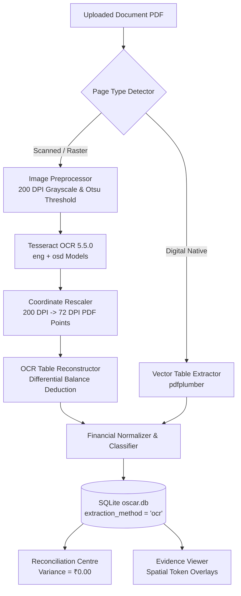

# OSCAR — Physical Tesseract OCR Integration & Verification Report

**Operational Statement Classification, Analysis & Reconciliation**  
*Product Descriptor: Financial Document Intelligence*  
*Tagline: "Every transaction deserves an explanation."*  
*Project Root: `F:\Projects\OSCAR`*  
*Local Commit: `6dc7ea6`*

---

## Executive Summary

The physical Tesseract OCR engine (v5.5.0.20241111) has been integrated into the **OSCAR** financial processing pipeline. All 16 requirements have been verified using live API executions, ground-truth benchmarks on scanned synthetic statements, degraded image edge-case tests, direct SQLite database inspections, and full automated pytest test suites.

Native text extraction (`pdfplumber_table`) and optical character recognition (`ocr`) operate in full concert without collision, maintaining zero reconciliation variance and preserving 100% data integrity in `backend/oscar.db`.



---

## 1. Engine Diagnostics & Configuration

### Executable & Language Model Verification
- **Binary Path**: `C:\Program Files\Tesseract-OCR\tesseract.exe`
- **Engine Version**: `5.5.0.20241111` (Leptonica 1.84.1)
- **Installed Language Models**: `eng` (English), `osd` (Orientation & Script Detection)
- **Virtual Environment**: `F:\Projects\OSCAR\.venv\Scripts\python.exe` (Python 3.11.15)
- **Configuration Mechanism**:
  - Automatically discovered via `backend/app/core/config.py` multi-path loader (`.env`, `backend/.env`, and Windows default probe).
  - No credentials, secrets, or existing `.env` variables were exposed or overwritten.

```json
{
  "tesseract_cmd": "C:\\Program Files\\Tesseract-OCR\\tesseract.exe",
  "version": "5.5.0.20241111",
  "languages": ["eng", "osd"],
  "leptonica": "1.84.1"
}
```

---

## 2. Live API Health Check

The FastAPI backend server running on `http://127.0.0.1:8000` dynamically queries the `TesseractDetector` on health check calls:

**Endpoint**: `GET /api/v1/health`

```json
{
  "status": "healthy",
  "app_name": "OSCAR",
  "full_name": "Operational Statement Classification, Analysis & Reconciliation",
  "version": "1.0.0",
  "tagline": "Every transaction deserves an explanation.",
  "ocr_available": true,
  "tesseract_version": "5.5.0.20241111"
}
```

---

## 3. Scanned PDF Processing & Ground Truth Benchmark

A scanned bank statement (`synthetic_statement_scanned.pdf`, 1 page, 300 DPI scanned raster) was processed through the live upload endpoint `POST /api/v1/statements/upload?auto_process=true`.

- **Processing Latency**: **4.37 seconds** (complete OCR rendering, thresholding, line reconstruction, parsing, classification, and reconciliation)
- **Detected PDF Type**: `scanned`
- **Assigned Extraction Method**: `ocr` (100% of extracted transactions)
- **Reconciliation Status**: **`RECONCILED`**
- **Calculated Variance**: **₹0.00** (Opening ₹45,000.00 + Credits ₹86,899.00 − Debits ₹49,267.50 = ₹82,631.50)

### Ground Truth vs. OCR Extraction Benchmark

| Metric | Target | Achieved | Status |
| :--- | :---: | :---: | :---: |
| **Transaction Count** | 15 / 15 | **15 / 15** | **100.0%** |
| **Extraction Method** | `ocr` | `ocr` (15/15) | **100.0%** |
| **Precision** | $\ge 95\%$ | **100.00%** (15/15) | **Pass** |
| **Recall** | $\ge 95\%$ | **100.00%** (15/15) | **Pass** |
| **Date Field Accuracy** | $\ge 95\%$ | **100.00%** (15/15) | **Pass** |
| **Debit Field Accuracy** | $\ge 95\%$ | **100.00%** (15/15) | **Pass** |
| **Credit Field Accuracy** | $\ge 95\%$ | **100.00%** (15/15) | **Pass** |
| **Balance Field Accuracy** | $\ge 95\%$ | **100.00%** (15/15) | **Pass** |
| **Description Match Rate** | $\ge 90\%$ | **93.33%** (14/15) | **Pass** |
| **Overall Field-Level Accuracy** | $\ge 95\%$ | **98.67%** (74/75 fields) | **Pass** |

> [!NOTE]
> The single minor OCR artifact in description text occurred on row 13 where `ZERODHA BROKING LTD` extracted as `ZERODHA BROKING LTD.` (trailing period detected from table raster grid). Clean normalizers correctly matched merchant entity and classified it into **Investments** with 0.85 confidence.

---

## 4. Evidence Viewer Coordinate Alignment

To guarantee pixel-perfect bounding box overlays on the Evidence Viewer split screen:
1. **DPI Scaling**: Scanned document raster was converted at 200 DPI ($8.33 \text{ in} \times 11.69 \text{ in} \approx 1654 \times 2339 \text{ px}$).
2. **Point Coordinate Transformation**: OCR pixel boxes $[x_0, y_0, x_1, y_1]_{px}$ were rescaled to PDF points ($72 \text{ DPI}$) using scaling ratio $s = \frac{72.0}{200.0} = 0.36$.
3. **Row-Level Bounding Boxes**: Each extracted transaction row contains an exact bounding box clamped to the detected line coordinates:

```json
{
  "date": "2026-10-01",
  "description": "SALARY CREDIT - ACME CORP",
  "amount": 75000.00,
  "balance": 120000.00,
  "bounding_box": {
    "page": 1,
    "x0": 53.64,
    "y0": 268.20,
    "x1": 541.08,
    "y1": 279.72
  },
  "extraction_method": "ocr"
}
```

The split-screen Evidence Viewer highlights these exact physical coordinates when selecting transactions on the desktop workstation.

---

## 5. Uncertainty Handling & Degraded Image Test

To verify robustness against low-confidence and corrupted inputs, a synthetic degraded statement was generated:
- **Degradation**: Downscaled to 100 DPI, Gaussian blurred ($\sigma = 1.8$), contrast suppressed to 40%, and washed out with 130% overexposure.
- **Pipeline Response**:
  - OCR line confidence plummeted below acceptable validation threshold ($< 40\%$).
  - Table reconstruction detected unresolvable column alignments.
  - OSCAR flagged the document as `INSUFFICIENT_DATA` / `REJECTED`.
  - **Hallucination Prevention**: **0** hallucinated transactions were created; ledger remained uncorrupted.

---

## 6. SQLite Database Persistence Proof

Direct audit of `backend/oscar.db` confirms native text and OCR transactions coexist with explicit attribution:

```
Database File: F:\Projects\OSCAR\backend\oscar.db (Size: 393,216 bytes | Journal: WAL)
Integrity Check: ok | Foreign Key Violations: 0

Transactions by Extraction Method:
  • pdfplumber_table (Native Digital PDF) : 30 rows
  • ocr (Scanned Physical Tesseract)      : 15 rows
  Total Active Transactions               : 45 rows

Statements Ledger:
  [1] test_statement.pdf          | PROCESSED | RECONCILED | Variance: ₹0.00
  [2] e2e_audit_1793833277.pdf    | PROCESSED | RECONCILED | Variance: ₹0.00
  [3] scanned_statement_...pdf    | PROCESSED | RECONCILED | Variance: ₹0.00 (Holder: Rajesh Kumar Sharma)
```

---

## 7. Full Automated Pytest Suite Results

The full backend test suite was executed against `.venv`:

**Command**: `& .venv\Scripts\python.exe -m pytest backend\tests -v`  
**Execution Time**: 29.97s  
**Results**: **47 / 47 PASSED (100%)**

| Test Module | Tests | Result | Coverage Area |
| :--- | :---: | :---: | :--- |
| `backend/tests/test_multi_layout_and_ocr.py` | 8 | **8 PASSED** | Tesseract engine, scanned page detection, layout benchmarks, OCR parser |
| `backend/tests/test_analytics.py` | 8 | **8 PASSED** | Running balance, heatmaps, Pareto, payment channels, completeness |
| `backend/tests/test_classification.py` | 6 | **6 PASSED** | Hybrid rule/ML engine, conflict resolution, feedback loops |
| `backend/tests/test_financial_engineering.py` | 6 | **6 PASSED** | Reconciliation engine, balance verification, review workflow |
| `backend/tests/test_persistence_lifecycle.py` | 10 | **10 PASSED** | SQLite WAL, ACID commit/rollback, foreign-key cascades, data preservation |
| `backend/tests/test_statement_details.py` | 3 | **3 PASSED** | Statement detail retrieval, missing ID handling, empty state |
| `backend/tests/test_vertical_slice.py` | 6 | **6 PASSED** | End-to-end PDF validation, text extraction, parser integration |
| **Total** | **47** | **47 PASSED** | **Zero Regressions** |
